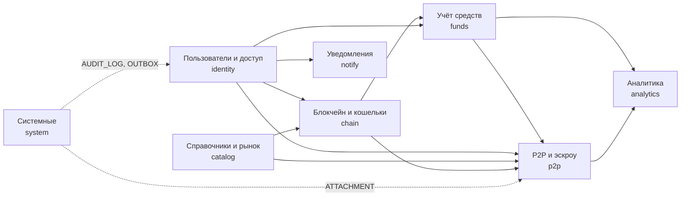
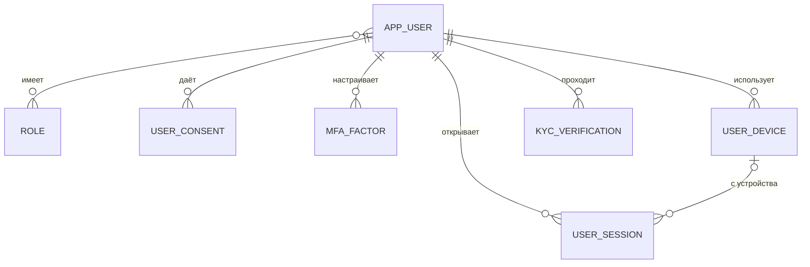
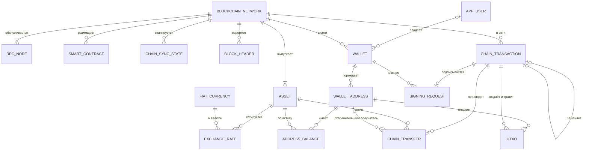
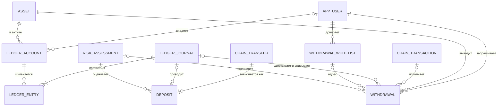
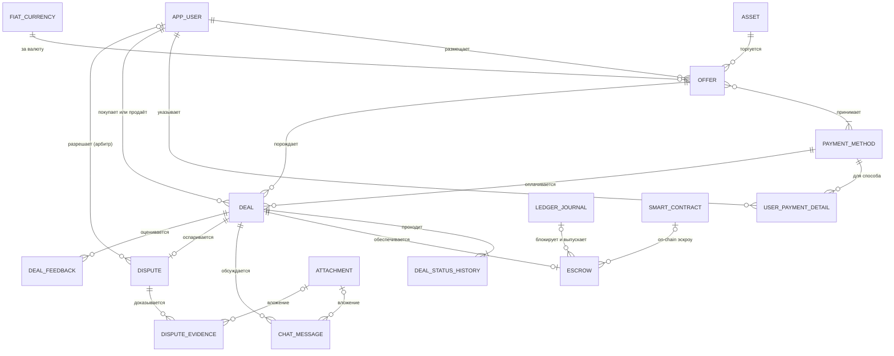
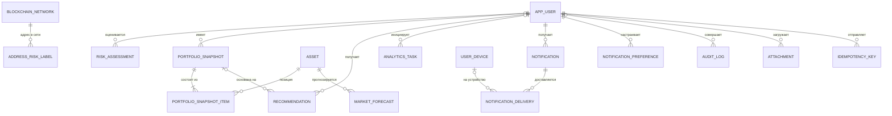
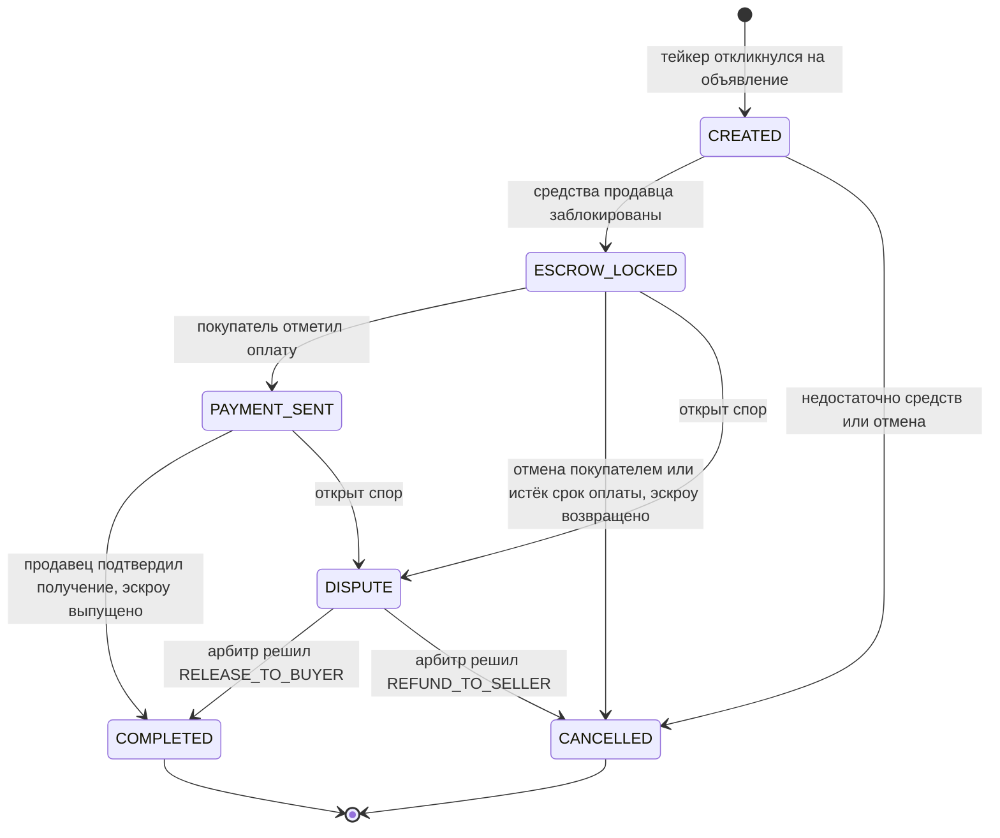
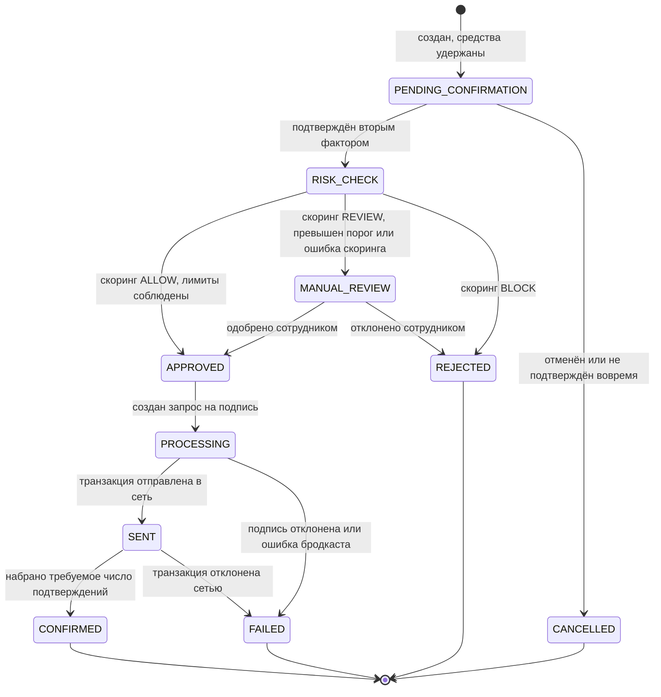
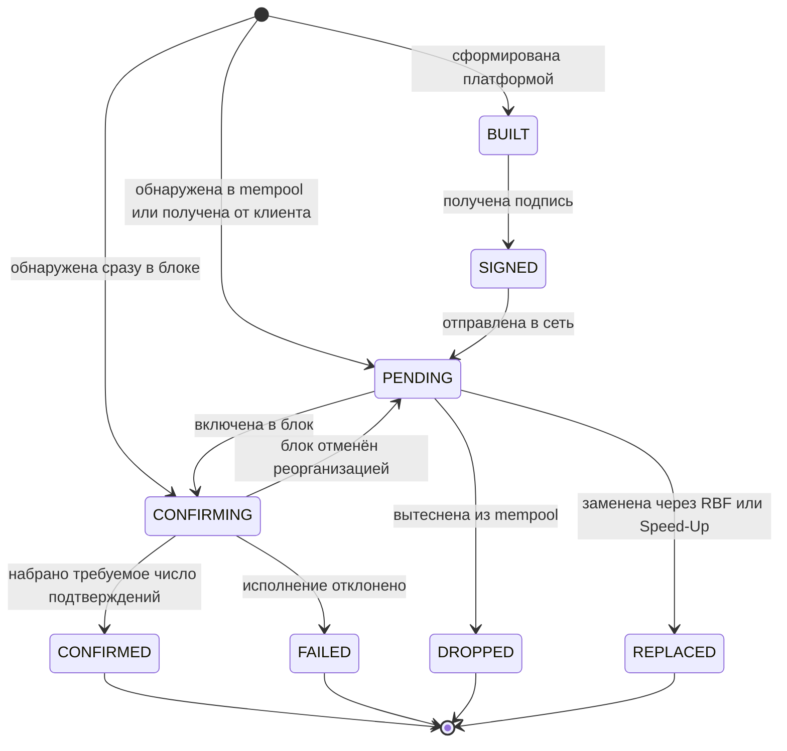
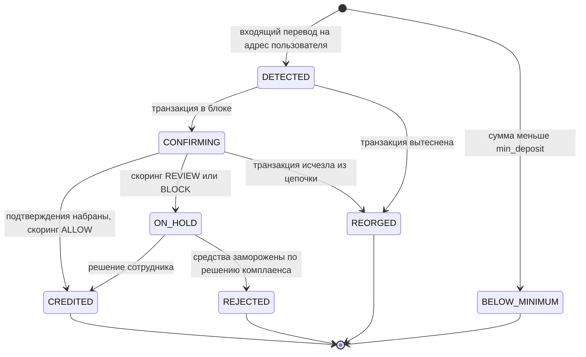

# AEON — Концептуальная и логическая модель данных

> **Документ:** Модель данных платформы AEON
> **Версия:** 1.0.0
> **Статус:** Проектирование (концептуальный и логический уровни)
> **СУБД:** PostgreSQL 16+, доступ через EF Core 9 (запись) и Dapper (аналитические чтения)
> **Основание:** [ABOUT.md](ABOUT.md) — архитектурная спецификация; упрощённая учебная версия модели — [docs/database/1.4-модель-данных-черновик.md](docs/database/1.4-модель-данных-черновик.md)

---

## Содержание

1. [Назначение и границы модели](#1-назначение-и-границы-модели)
2. [Ключевые проектные решения](#2-ключевые-проектные-решения)
3. [Соглашения](#3-соглашения)
4. [Концептуальная модель](#4-концептуальная-модель)
5. [Логическая модель](#5-логическая-модель)
   - 5.1. Пользователи и доступ (`identity`)
   - 5.2. Справочники и рыночные данные (`catalog`)
   - 5.3. Блокчейн-инфраструктура, кошельки и транзакции (`chain`)
   - 5.4. Учёт средств, депозиты и выводы (`funds`)
   - 5.5. P2P-торговля, эскроу и споры (`p2p`)
   - 5.6. Аналитика и скоринг (`analytics`)
   - 5.7. Уведомления (`notify`)
   - 5.8. Системные данные (`system`)
6. [Жизненные циклы сущностей](#6-жизненные-циклы-сущностей)
7. [Учёт средств и сквозные сценарии](#7-учёт-средств-и-сквозные-сценарии)
8. [Нормализация и осознанные отступления](#8-нормализация-и-осознанные-отступления)
9. [Данные вне PostgreSQL](#9-данные-вне-postgresql)
10. [Рекомендации к физической модели](#10-рекомендации-к-физической-модели)
11. [Трассировка требований ABOUT.md](#11-трассировка-требований-aboutmd)
12. [Отличия от черновика раздела 1.4](#12-отличия-от-черновика-раздела-14)

---

## 1. Назначение и границы модели

Модель описывает данные, которые хранит основная реляционная база AEON: пользователей и доступ, кошельки и адреса в сетях EVM, Bitcoin и Solana, блокчейн-транзакции и их подтверждения, внутренний учёт балансов, депозиты и выводы, P2P-объявления, сделки, эскроу, чат и споры, результаты скоринга и аналитики портфеля, уведомления, журнал аудита и служебные таблицы надёжной доставки событий.

Модель строится на двух уровнях:

- **концептуальный** (раздел 4): сущности предметной области, их группировка по модулям и связи с кратностью, без типов данных;
- **логический** (раздел 5): атрибуты, типы, первичные, внешние и уникальные ключи, обязательность, ограничения и перечисления значений. Модель приведена к 3НФ, отступления перечислены в разделе 8.

Физические решения (индексы, партиционирование, сроки хранения) даны в разделе 10 как рекомендации и в саму логическую модель не входят.

**Вне модели:** приватные ключи и seed-фразы, мастер-ключи шифрования, файлы, документы KYC, распределённые блокировки и кэш котировок. Где хранятся эти данные, описано в разделе 9.

---

## 2. Ключевые проектные решения

| № | Решение | Обоснование | ABOUT.md |
|---|---|---|---|
| Р-1 | Приватные ключи в БД не хранятся. Кошелёк хранит только `key_ref` — ссылку на ключ в Vault/KMS/MPC — и публичный `xpub` для генерации адресов | Хранение ключей в SQL, даже зашифрованных, недопустимо | 2.1, 3.1 |
| Р-2 | Модель владения задаётся атрибутом `custody_type` кошелька: `CUSTODIAL`, `NON_CUSTODIAL`, `SMART_ACCOUNT`. Обе модели поддерживаются одной схемой | Выбор модели ключей отложен до этапа 1 roadmap. Схема не должна от него зависеть | 2.1, 6 (этап 1) |
| Р-3 | Системные кошельки (`HOT`, `WARM`, `COLD`, `GAS_TANK`) хранятся в той же сущности, что и пользовательские, и различаются атрибутом `purpose` | Концепция Hot/Warm/Cold, консолидация депозитов, пополнение газа | 2.1 |
| Р-4 | Балансы кастодиальных пользователей ведутся во **внутренней двойной бухгалтерии** (`LEDGER_ACCOUNT`, `LEDGER_JOURNAL`, `LEDGER_ENTRY`), а не полем «баланс» у кошелька | Внутренний балансовый эскроу, защита от двойного списания, сверка с блокчейном | 2.2, 6 (этап 3) |
| Р-5 | Блокчейн-транзакция (`CHAIN_TRANSACTION`) отделена от бизнес-операций (`DEPOSIT`, `WITHDRAWAL`, `ESCROW`). Одна транзакция может содержать несколько переводов (`CHAIN_TRANSFER`) и исполнять несколько выводов | Батчинг BTC, несколько событий ERC-20 в одной транзакции, консолидация | 2.4 |
| Р-6 | Модели UTXO и Account разведены: для Bitcoin есть `UTXO`, для EVM — `next_nonce` у адреса, параметры комиссий специфичны для сети и лежат в `fee_params` (JSONB) | Различие моделей UTXO и Account нельзя скрыть за одним набором колонок | 2.4 |
| Р-7 | Реорганизации отслеживаются через окно заголовков блоков (`BLOCK_HEADER`) и курсоры сканеров (`CHAIN_SYNC_STATE`). Ускорение и замена транзакций — через `replaces_tx_id` | Chain reorgs, RBF, CPFP, Speed-Up | 2.4 |
| Р-8 | Статусы сделки соответствуют конечному автомату из ABOUT.md, каждый переход фиксируется в `DEAL_STATUS_HISTORY` | Stateless, аудит, разбор споров | 3.4 |
| Р-9 | События публикуются через Transactional Outbox (`OUTBOX_MESSAGE`), потребители идемпотентны (`INBOX_MESSAGE`) | Нет рассинхронизации между БД и брокером | 2.2, 3.2 |
| Р-10 | Единственный источник миграций — EF Core в `AEON.Infrastructure/Persistence/Migrations`. Бизнес-логика в хранимых процедурах не размещается. Допускаются только представления для чтения | Устранение коллизии `database/migrations` и `Persistence/Migrations` | 2.3 |
| Р-11 | Данные сервиса аналитики лежат в отдельной схеме `analytics`. Ядро читает результаты скоринга по ссылке, а не вызывает расчёт внутри транзакции | Асинхронная тяжёлая аналитика, gRPC для синхронного скоринга | 2.5 |

---

## 3. Соглашения

### 3.1. Типы данных

| Логический тип | Тип PostgreSQL | Где применяется |
|---|---|---|
| Идентификатор сущности | `uuid` (UUIDv7, генерируется приложением) | Все сущности, создаваемые пользователями и системой. UUIDv7 упорядочен по времени и не фрагментирует B-tree индекс |
| Идентификатор справочника | `smallint` / `integer` | Сети, активы, роли, способы оплаты, правила |
| Идентификатор журнальной записи | `bigint` (identity) | Таблицы с большим потоком только на добавление: проводки, аудит, курсы |
| Количество криптоактива | `numeric(38,18)` | Суммы, балансы, комиссии в активе. Точно хранит до 18 знаков после запятой и до 10²⁰ целых единиц |
| Сумма в фиате | `numeric(24,4)` | Лимиты и суммы оплаты. Округление до `minor_units` валюты выполняется приложением |
| Курс и цена | `numeric(38,18)` | Цена единицы актива в фиате, включая активы с очень малой ценой |
| Процент | `numeric(7,4)` | Комиссии и наценки: `0.1000` = 0,1 % |
| Дата и время | `timestamptz` | Все отметки времени, только UTC |
| Строка | `varchar(n)`, `text`, `citext` (email) | Длина указана в таблицах |
| Перечисление | `varchar(32)` + `CHECK` | Статусы и типы. Выбрано вместо `enum` PostgreSQL, чтобы новое значение добавлялось обычной миграцией EF Core |
| Полуструктурированные данные | `jsonb` | Параметры, специфичные для сети, факторы скоринга, полезная нагрузка событий |
| Зашифрованные данные | `bytea` | Реквизиты, TOTP-секреты. Шифрование конвертное (envelope), ключ шифрования — в KMS |
| Хэш | `char(64)` | SHA-256 в hex |
| IP-адрес | `inet` | Сессии, согласия, аудит |

### 3.2. Именование и общие поля

- Таблицы и колонки — `snake_case`, таблицы в единственном числе, группировка по схемам PostgreSQL (`identity`, `catalog`, `chain`, `funds`, `p2p`, `analytics`, `notify`, `system`). В документе сущности записаны прописными буквами (`APP_USER`), в базе — строчными (`identity.app_user`).
- Первичный ключ — `<сущность>_id`. Внешний ключ называется по роли связи (`owner_user_id`, `buyer_id`, `arbiter_id`).
- `created_at` — время создания, `updated_at` — время последнего изменения. Неизменяемые сущности (проводки, история статусов, сообщения чата, аудит) не имеют `updated_at`.
- `version integer` — токен оптимистичной блокировки у агрегатов с конкурентными изменениями: `APP_USER`, `LEDGER_ACCOUNT`, `OFFER`, `DEAL`, `WITHDRAWAL`, `DISPUTE`. В EF Core может быть заменён системной колонкой `xmin`.
- Финансовые записи физически не удаляются. Пользователь при удалении обезличивается (`status = DELETED`, `deleted_at`), строка остаётся, чтобы не разрушать историю операций.

### 3.3. Обозначения в таблицах атрибутов

**PK** — первичный ключ, **FK → X** — внешний ключ на сущность X, **UK** — уникальный ключ (составной UK описан под таблицей), **Обяз.** — `да`, если значение NOT NULL.

---

## 4. Концептуальная модель

### 4.1. Предметные области и сущности

Модель содержит 57 сущностей, сгруппированных в восемь модулей. Модули совпадают с границами `AEON.Application` и схемами базы.

| Модуль / схема | Сущность | Назначение |
|---|---|---|
| **Пользователи и доступ** `identity` | APP_USER | Учётная запись: вход, профиль, уровень верификации, состояние |
| | ROLE | Роль доступа: пользователь, арбитр, поддержка, комплаенс, администратор |
| | USER_ROLE | Назначение роли пользователю (ассоциативная) |
| | USER_CONSENT | Согласия с документами (условия, политика, обработка ПДн) с версией документа |
| | MFA_FACTOR | Второй фактор: TOTP, WebAuthn/passkey, OTP по почте и SMS |
| | USER_DEVICE | Устройство: платформа, push-токен, результат проверки целостности |
| | USER_SESSION | Сессия входа с refresh-токеном |
| | KYC_VERIFICATION | Заявка на верификацию личности у внешнего провайдера |
| **Справочники и рынок** `catalog` | BLOCKCHAIN_NETWORK | Блокчейн-сеть: семейство, chain id, требуемые подтверждения |
| | ASSET | Криптоактив в конкретной сети: нативная монета, ERC-20, SPL |
| | FIAT_CURRENCY | Фиатная валюта ISO 4217 |
| | EXCHANGE_RATE | Котировка актива к фиату от источника на момент времени |
| | FEE_RULE | Правило комиссии платформы |
| | LIMIT_POLICY | Лимит операций в зависимости от уровня KYC |
| **Блокчейн** `chain` | RPC_NODE | RPC-узел сети с приоритетом и состоянием здоровья (failover) |
| | SMART_CONTRACT | Реестр контрактов платформы: эскроу, EntryPoint, Paymaster |
| | CHAIN_SYNC_STATE | Курсор сканера: последний обработанный блок |
| | BLOCK_HEADER | Окно последних заголовков блоков для обнаружения реорганизаций |
| | WALLET | Кошелёк пользователя или системы в одной сети, ссылка на ключ |
| | WALLET_ADDRESS | Адрес кошелька (HD-деривация, nonce, подтверждение владения) |
| | ADDRESS_BALANCE | Наблюдаемый on-chain баланс адреса по активу |
| | CHAIN_TRANSACTION | Транзакция в блокчейне и её жизненный цикл |
| | CHAIN_TRANSFER | Отдельный перевод актива внутри транзакции |
| | UTXO | Непотраченный выход Bitcoin |
| | SIGNING_REQUEST | Запрос в сервис подписи с решением политики безопасности |
| **Учёт средств** `funds` | LEDGER_ACCOUNT | Счёт внутреннего учёта: пользовательский или системный, в одном активе |
| | LEDGER_JOURNAL | Бухгалтерская операция (сумма проводок равна нулю) |
| | LEDGER_ENTRY | Проводка по счёту |
| | DEPOSIT | Зачисление входящего перевода на кастодиальный адрес |
| | WITHDRAWAL | Заявка пользователя на вывод средств |
| | WITHDRAWAL_WHITELIST | Доверенный адрес для вывода |
| **P2P** `p2p` | PAYMENT_METHOD | Справочник способов фиатной оплаты |
| | USER_PAYMENT_DETAIL | Реквизиты пользователя для получения оплаты |
| | OFFER | P2P-объявление на покупку или продажу актива |
| | OFFER_PAYMENT_METHOD | Способ оплаты, принимаемый в объявлении (ассоциативная) |
| | DEAL | P2P-сделка между покупателем и продавцом |
| | DEAL_STATUS_HISTORY | История переходов конечного автомата сделки |
| | ESCROW | Блокировка средств продавца по сделке: внутренняя или в смарт-контракте |
| | CHAT_MESSAGE | Сообщение в чате сделки |
| | DISPUTE | Спор по сделке и решение арбитра |
| | DISPUTE_EVIDENCE | Доказательство, приложенное к спору |
| | DEAL_FEEDBACK | Отзыв участника о контрагенте после сделки |
| **Аналитика** `analytics` | RISK_ASSESSMENT | Результат скоринга риска операции или адреса |
| | ADDRESS_RISK_LABEL | Метка риска адреса (санкции, миксеры, мошенничество) для AML |
| | PORTFOLIO_SNAPSHOT | Снимок портфеля пользователя на момент времени |
| | PORTFOLIO_SNAPSHOT_ITEM | Позиция снимка портфеля по активу |
| | RECOMMENDATION | Рекомендация по портфелю для пользователя |
| | MARKET_FORECAST | Рыночный прогноз цены актива на горизонт |
| | ANALYTICS_TASK | Асинхронная задача сервиса аналитики |
| **Уведомления** `notify` | NOTIFICATION | Уведомление пользователю (лента в приложении) |
| | NOTIFICATION_DELIVERY | Попытка доставки по каналу: push, email, SMS, Telegram |
| | NOTIFICATION_PREFERENCE | Настройка каналов по категориям событий |
| **Системные** `system` | ATTACHMENT | Метаданные загруженного файла (сам файл в объектном хранилище) |
| | AUDIT_LOG | Журнал аудита действий пользователей, администраторов и системы |
| | OUTBOX_MESSAGE | Исходящее событие Transactional Outbox |
| | INBOX_MESSAGE | Отметка об обработке входящего сообщения (идемпотентность) |
| | IDEMPOTENCY_KEY | Ключ идемпотентности API-запроса |

**Понятия, которые не стали сущностями:**

| Понятие | Решение |
|---|---|
| Покупатель, продавец, арбитр | Роли пользователя в конкретной сделке или споре, выражены внешними ключами `buyer_id`, `seller_id`, `arbiter_id` |
| Баланс кастодиального пользователя | Остаток `LEDGER_ACCOUNT` типа `USER_MAIN` |
| Сумма «в эскроу» и «в выводе» | Вычисляются по активным `ESCROW` и `WITHDRAWAL` |
| Количество подтверждений | Вычисляется как `CHAIN_SYNC_STATE.chain_tip_number − block_number + 1` |
| Рейтинг продавца, процент завершённых сделок | Агрегируются из `DEAL` и `DEAL_FEEDBACK` в материализованное представление `p2p.user_trade_stats` |
| QR-код адреса | Строится из адреса на клиенте |
| Таймер сделки | Атрибут `DEAL.payment_deadline_at`. Отсчёт ведут клиенты, истечение обрабатывает `P2POrderTimeoutWorker` |
| Текущий курс | Последняя запись `EXCHANGE_RATE`, кэшируется в Redis |

### 4.2. Обзор связей между модулями

### 4.3. Концептуальные ER-диаграммы

**Пользователи и доступ**

**Справочники, блокчейн и кошельки**

**Учёт средств, депозиты и выводы**

**P2P-торговля, эскроу и споры**

**Аналитика, уведомления, системные**

### 4.4. Содержательное описание ключевых связей

| Связь | Кратность | Смысл |
|---|---|---|
| Пользователь – Роль | M : N | У сотрудника может быть несколько ролей, например `SUPPORT` и `ARBITER`. Разрешается через `USER_ROLE` |
| Сеть – Актив | 1 : N | USDT в Ethereum и USDT в Polygon — разные активы с разными контрактами и `decimals` |
| Пользователь – Кошелёк | 1 : N, необязательная со стороны кошелька | Один кастодиальный кошелёк на сеть плюс любое число подключённых некастодиальных. У системных кошельков владельца нет |
| Кошелёк – Адрес | 1 : N | Bitcoin выдаёт новый адрес на каждый депозит и сдачу, в EVM и Solana обычно один адрес |
| Транзакция – Перевод | 1 : N | Одна транзакция содержит несколько выходов BTC или несколько событий `Transfer` ERC-20 |
| Транзакция – Транзакция | 1 : 0..1 | Новая транзакция заменяет старую (RBF, Speed-Up, отмена с тем же nonce) |
| Перевод – Депозит | 1 : 0..1 | Депозитом становится только перевод на адрес кастодиального кошелька пользователя |
| Транзакция – Вывод | 1 : N | Батч-транзакция Bitcoin исполняет несколько заявок на вывод |
| Операция – Проводки | 1 : N (не менее двух) | Сумма проводок операции равна нулю (двойная запись) |
| Объявление – Способ оплаты | M : N | Разрешается через `OFFER_PAYMENT_METHOD`, где у продавца указаны реквизиты |
| Объявление – Сделка | 1 : N | По одному объявлению идёт много сделок, пока есть `available_amount` |
| Сделка – Эскроу | 1 : 0..1 | Эскроу создаётся при блокировке средств продавца |
| Сделка – Спор | 1 : 0..1 | По сделке открывается не более одного спора |
| Сделка – Отзыв | 1 : 0..2 | Каждый из двух участников оставляет не более одного отзыва |
| Уведомление – Доставка | 1 : N | Одно уведомление уходит в несколько каналов и на несколько устройств |

---

## 5. Логическая модель

### 5.1. Пользователи и доступ (`identity`)

#### APP_USER — пользователь (`identity.app_user`)

| Атрибут | Тип | Ключ | Обяз. | Описание |
|---|---|---|---|---|
| user_id | uuid | PK | да | Идентификатор пользователя |
| email | citext | UK | да | Электронная почта, логин для входа. Регистр не учитывается |
| email_verified_at | timestamptz | | нет | Момент подтверждения почты |
| phone | varchar(20) | UK | нет | Телефон в формате E.164 |
| phone_verified_at | timestamptz | | нет | Момент подтверждения телефона |
| password_hash | varchar(255) | | нет | Хэш Argon2id в формате PHC (соль и параметры внутри строки). NULL — вход только по passkey |
| nickname | varchar(32) | UK | да | Публичное имя в P2P. Виден контрагентам вместо почты и ФИО |
| full_name | varchar(150) | | нет | ФИО. Заполняется по результату KYC |
| country_code | char(2) | | нет | Страна проживания, ISO 3166-1 alpha-2 |
| locale | varchar(10) | | да | Язык интерфейса, например `ru-RU` |
| time_zone | varchar(64) | | да | Часовой пояс IANA, например `Europe/Moscow` |
| kyc_level | smallint | | да | Текущий уровень верификации: 0 — нет, 1 — базовый, 2 — полный, 3 — расширенный |
| status | varchar(32) | | да | `PENDING_VERIFICATION`, `ACTIVE`, `BLOCKED`, `DELETED` |
| blocked_reason | varchar(500) | | нет | Причина блокировки администратором |
| failed_login_count | smallint | | да | Неудачные попытки входа подряд, по умолчанию 0 |
| locked_until | timestamptz | | нет | Временная блокировка входа после перебора пароля |
| last_login_at | timestamptz | | нет | Время последнего успешного входа |
| telegram_chat_id | bigint | UK | нет | Привязка Telegram-бота для уведомлений |
| created_at | timestamptz | | да | Дата регистрации |
| updated_at | timestamptz | | да | Дата последнего изменения |
| deleted_at | timestamptz | | нет | Момент удаления и обезличивания |
| version | integer | | да | Токен оптимистичной блокировки |

Ограничения: `kyc_level BETWEEN 0 AND 3`; `status = 'DELETED'` ⇔ `deleted_at IS NOT NULL`; `password_hash IS NOT NULL` или у пользователя есть фактор `WEBAUTHN` (проверяется приложением).

#### ROLE — роль (`identity.role`)

| Атрибут | Тип | Ключ | Обяз. | Описание |
|---|---|---|---|---|
| role_id | smallint | PK | да | Идентификатор роли |
| code | varchar(32) | UK | да | `USER`, `ARBITER`, `SUPPORT`, `COMPLIANCE`, `ADMIN` |
| name | varchar(100) | | да | Отображаемое название |
| description | varchar(500) | | нет | Описание полномочий |

Детальные права (permissions) задаются политиками авторизации ASP.NET Core по коду роли и в базе не хранятся.

#### USER_ROLE — назначение роли (`identity.user_role`)

| Атрибут | Тип | Ключ | Обяз. | Описание |
|---|---|---|---|---|
| user_id | uuid | PK, FK → APP_USER | да | Пользователь |
| role_id | smallint | PK, FK → ROLE | да | Роль |
| granted_by | uuid | FK → APP_USER | нет | Администратор, выдавший роль. NULL — выдана системой при регистрации |
| granted_at | timestamptz | | да | Момент назначения |

#### USER_CONSENT — согласие (`identity.user_consent`)

| Атрибут | Тип | Ключ | Обяз. | Описание |
|---|---|---|---|---|
| consent_id | uuid | PK | да | Идентификатор записи |
| user_id | uuid | FK → APP_USER | да | Пользователь |
| consent_type | varchar(32) | | да | `TERMS`, `PRIVACY_POLICY`, `PERSONAL_DATA`, `MARKETING` |
| document_version | varchar(20) | | да | Версия документа, с которой согласился пользователь |
| accepted_at | timestamptz | | да | Момент согласия |
| revoked_at | timestamptz | | нет | Момент отзыва согласия |
| ip_address | inet | | да | IP-адрес в момент согласия |

UK: (`user_id`, `consent_type`, `document_version`). При выходе новой версии документа создаётся новая запись, история не перезаписывается.

#### MFA_FACTOR — фактор двухфакторной аутентификации (`identity.mfa_factor`)

| Атрибут | Тип | Ключ | Обяз. | Описание |
|---|---|---|---|---|
| factor_id | uuid | PK | да | Идентификатор фактора |
| user_id | uuid | FK → APP_USER | да | Владелец |
| factor_type | varchar(32) | | да | `TOTP`, `WEBAUTHN`, `EMAIL_OTP`, `SMS_OTP` |
| label | varchar(100) | | нет | Название, например «iPhone Face ID» |
| secret_encrypted | bytea | | нет | TOTP-секрет, зашифрованный конвертным шифрованием |
| credential_id | bytea | UK | нет | Идентификатор учётных данных WebAuthn |
| public_key | bytea | | нет | Открытый ключ WebAuthn (COSE) |
| sign_count | bigint | | нет | Счётчик подписей WebAuthn для обнаружения клонирования |
| is_primary | boolean | | да | Фактор по умолчанию для подтверждения операций |
| created_at | timestamptz | | да | Дата подключения |
| last_used_at | timestamptz | | нет | Последнее использование |
| revoked_at | timestamptz | | нет | Дата отключения |

Ограничения: `factor_type = 'TOTP'` ⇒ `secret_encrypted IS NOT NULL`; `factor_type = 'WEBAUTHN'` ⇒ `credential_id` и `public_key` NOT NULL. Одноразовые коды OTP в базе не хранятся, они живут в Redis с TTL.

#### USER_DEVICE — устройство (`identity.user_device`)

| Атрибут | Тип | Ключ | Обяз. | Описание |
|---|---|---|---|---|
| device_id | uuid | PK | да | Идентификатор устройства |
| user_id | uuid | FK → APP_USER | да | Владелец |
| platform | varchar(16) | | да | `IOS`, `ANDROID`, `WEB` |
| device_name | varchar(100) | | нет | Модель устройства или браузер |
| os_version | varchar(20) | | нет | Версия ОС |
| app_version | varchar(20) | | нет | Версия клиента |
| push_provider | varchar(16) | | нет | `APNS`, `FCM`, `WEB_PUSH` |
| push_token | varchar(512) | UK | нет | Токен push-уведомлений |
| integrity_status | varchar(16) | | да | Проверка jailbreak и root: `OK`, `COMPROMISED`, `UNKNOWN` |
| is_trusted | boolean | | да | Доверенное устройство (вход без повторного 2FA) |
| created_at | timestamptz | | да | Первая регистрация |
| last_seen_at | timestamptz | | да | Последняя активность |
| revoked_at | timestamptz | | нет | Отзыв устройства пользователем |

Ограничение: `push_provider` и `push_token` заполняются вместе. С устройства со статусом `COMPROMISED` выводы и выпуск эскроу запрещены политикой безопасности.

#### USER_SESSION — сессия (`identity.user_session`)

| Атрибут | Тип | Ключ | Обяз. | Описание |
|---|---|---|---|---|
| session_id | uuid | PK | да | Идентификатор сессии |
| user_id | uuid | FK → APP_USER | да | Пользователь |
| device_id | uuid | FK → USER_DEVICE | нет | Устройство, если оно зарегистрировано |
| refresh_token_hash | char(64) | UK | да | SHA-256 refresh-токена. Сам токен не хранится |
| ip_address | inet | | да | IP при создании |
| user_agent | varchar(500) | | нет | User-Agent клиента |
| created_at | timestamptz | | да | Начало сессии |
| last_activity_at | timestamptz | | да | Последнее обновление токена |
| expires_at | timestamptz | | да | Срок действия refresh-токена |
| revoked_at | timestamptz | | нет | Момент отзыва |
| revoke_reason | varchar(32) | | нет | `LOGOUT`, `PASSWORD_CHANGED`, `ADMIN`, `SUSPICIOUS`, `ROTATED` |

Access-токены (JWT) короткоживущие и в базе не хранятся.

#### KYC_VERIFICATION — верификация личности (`identity.kyc_verification`)

| Атрибут | Тип | Ключ | Обяз. | Описание |
|---|---|---|---|---|
| verification_id | uuid | PK | да | Идентификатор заявки |
| user_id | uuid | FK → APP_USER | да | Пользователь |
| target_level | smallint | | да | Уровень, на который подана заявка (1–3) |
| provider | varchar(32) | | да | Код KYC-провайдера |
| external_applicant_id | varchar(100) | | да | Идентификатор заявителя у провайдера |
| status | varchar(32) | | да | `CREATED`, `PENDING`, `APPROVED`, `REJECTED`, `RESUBMISSION_REQUESTED`, `EXPIRED` |
| reject_reason | varchar(500) | | нет | Причина отказа |
| reviewed_by | uuid | FK → APP_USER | нет | Сотрудник `COMPLIANCE` при ручной проверке |
| submitted_at | timestamptz | | нет | Отправка документов |
| decided_at | timestamptz | | нет | Решение |
| expires_at | timestamptz | | нет | Срок действия верификации |
| created_at | timestamptz | | да | Создание заявки |
| updated_at | timestamptz | | да | Последнее изменение |

UK: (`provider`, `external_applicant_id`). Документы и фото остаются у провайдера, в AEON хранится только ссылка и результат. При `APPROVED` обновляется `APP_USER.kyc_level`.

---

### 5.2. Справочники и рыночные данные (`catalog`)

#### BLOCKCHAIN_NETWORK — блокчейн-сеть (`catalog.blockchain_network`)

| Атрибут | Тип | Ключ | Обяз. | Описание |
|---|---|---|---|---|
| network_id | smallint | PK | да | Идентификатор сети |
| code | varchar(32) | UK | да | Например `ETH_MAINNET`, `ETH_SEPOLIA`, `POLYGON`, `ARBITRUM`, `BSC`, `BTC_MAINNET`, `BTC_TESTNET`, `SOL_MAINNET`, `SOL_DEVNET` |
| name | varchar(100) | | да | Отображаемое название |
| family | varchar(16) | | да | Семейство: `EVM`, `BITCOIN`, `SOLANA`. Определяет, какой модуль `AEON.Blockchain.*` обслуживает сеть |
| chain_id | bigint | UK | нет | EVM chain id (1, 137, 11155111…). Только для `EVM` |
| is_testnet | boolean | | да | Тестовая сеть |
| required_confirmations | integer | | да | Подтверждений до зачисления (BTC — 3, Ethereum — 12; для Solana — 1 при уровне `finalized`) |
| avg_block_time_ms | integer | | да | Среднее время блока, для таймаутов и прогноза подтверждения |
| supports_eip1559 | boolean | | да | Поддержка динамической комиссии EIP-1559 (для EVM) |
| explorer_tx_url | varchar(255) | | нет | Шаблон ссылки на обозреватель, например `https://sepolia.etherscan.io/tx/{hash}` |
| is_active | boolean | | да | Сеть доступна для операций |
| created_at | timestamptz | | да | Создание |
| updated_at | timestamptz | | да | Изменение |

Ограничение: `family = 'EVM'` ⇔ `chain_id IS NOT NULL`.

#### ASSET — криптоактив (`catalog.asset`)

| Атрибут | Тип | Ключ | Обяз. | Описание |
|---|---|---|---|---|
| asset_id | integer | PK | да | Идентификатор актива |
| network_id | smallint | FK → BLOCKCHAIN_NETWORK | да | Сеть выпуска |
| symbol | varchar(16) | | да | Тикер: `ETH`, `USDT`, `BTC`, `SOL` |
| name | varchar(100) | | да | Название |
| asset_type | varchar(16) | | да | `NATIVE`, `ERC20`, `SPL` |
| contract_address | varchar(64) | | нет | Адрес контракта ERC-20 или mint SPL. NULL для нативной монеты |
| decimals | smallint | | да | Знаков после запятой в сети, от 0 до 18 |
| price_source_id | varchar(64) | | нет | Идентификатор актива у поставщика котировок (например, CoinGecko id) |
| min_deposit | numeric(38,18) | | да | Минимальная сумма депозита. Меньшие суммы не зачисляются |
| min_withdrawal | numeric(38,18) | | да | Минимальная сумма вывода |
| deposit_enabled | boolean | | да | Депозиты разрешены |
| withdrawal_enabled | boolean | | да | Выводы разрешены |
| p2p_enabled | boolean | | да | Актив доступен в P2P |
| is_active | boolean | | да | Актив отображается в приложении |
| created_at | timestamptz | | да | Создание |
| updated_at | timestamptz | | да | Изменение |

UK: (`network_id`, `symbol`); (`network_id`, `contract_address`); частичный UK (`network_id`) WHERE `asset_type = 'NATIVE'` — в сети одна нативная монета, ею оплачиваются комиссии сети. Ограничения: `asset_type = 'NATIVE'` ⇔ `contract_address IS NULL`; `decimals BETWEEN 0 AND 18`. Переводы токенов, которых нет в справочнике, не сохраняются.

#### FIAT_CURRENCY — фиатная валюта (`catalog.fiat_currency`)

| Атрибут | Тип | Ключ | Обяз. | Описание |
|---|---|---|---|---|
| code | char(3) | PK | да | Код ISO 4217: `RUB`, `USD`, `EUR` |
| name | varchar(64) | | да | Название |
| symbol | varchar(8) | | да | Символ: ₽, $, € |
| minor_units | smallint | | да | Знаков дробной части (2 для RUB) |
| is_active | boolean | | да | Доступна в P2P |

#### EXCHANGE_RATE — котировка (`catalog.exchange_rate`)

| Атрибут | Тип | Ключ | Обяз. | Описание |
|---|---|---|---|---|
| rate_id | bigint | PK | да | Идентификатор записи |
| asset_id | integer | FK → ASSET | да | Котируемый актив |
| fiat_code | char(3) | FK → FIAT_CURRENCY | да | Валюта котировки |
| rate | numeric(38,18) | | да | Цена одной единицы актива в фиате, больше 0 |
| source | varchar(32) | | да | `COINGECKO`, `BINANCE`, `CHAINLINK` |
| observed_at | timestamptz | | да | Момент котировки у источника |
| created_at | timestamptz | | да | Момент записи в AEON |

UK: (`asset_id`, `fiat_code`, `source`, `observed_at`). Пишется `ExchangeRateSyncWorker`, используется для плавающих цен P2P, оценки портфеля, пересчёта лимитов в фиат и как история цен для аналитики.

#### FEE_RULE — правило комиссии (`catalog.fee_rule`)

| Атрибут | Тип | Ключ | Обяз. | Описание |
|---|---|---|---|---|
| fee_rule_id | integer | PK | да | Идентификатор правила |
| operation | varchar(32) | | да | `WITHDRAWAL`, `P2P_MAKER`, `P2P_TAKER` |
| asset_id | integer | FK → ASSET | нет | Актив. NULL — правило для всех активов |
| fixed_fee | numeric(38,18) | | да | Фиксированная часть в единицах актива, по умолчанию 0 |
| percent_fee | numeric(7,4) | | да | Процентная часть, по умолчанию 0 |
| min_fee | numeric(38,18) | | нет | Нижняя граница |
| max_fee | numeric(38,18) | | нет | Верхняя граница |
| valid_from | timestamptz | | да | Начало действия |
| valid_to | timestamptz | | нет | Окончание действия |

Ограничения: `asset_id IS NULL` ⇒ `fixed_fee = 0` (фиксированную сумму нельзя задать без актива); периоды правил для одной пары (`operation`, `asset_id`) не пересекаются (exclusion constraint по `tstzrange`). Комиссия вывода включает компенсацию комиссии сети.

#### LIMIT_POLICY — лимит операций (`catalog.limit_policy`)

| Атрибут | Тип | Ключ | Обяз. | Описание |
|---|---|---|---|---|
| policy_id | integer | PK | да | Идентификатор политики |
| kyc_level | smallint | | да | Уровень KYC, к которому применяется лимит |
| operation | varchar(32) | | да | `WITHDRAWAL`, `P2P_DEAL` |
| period | varchar(16) | | да | `SINGLE` (одна операция), `DAY`, `MONTH` |
| max_amount | numeric(24,4) | | да | Максимум в фиатном эквиваленте |
| fiat_code | char(3) | FK → FIAT_CURRENCY | да | Валюта лимита |
| valid_from | timestamptz | | да | Начало действия |
| valid_to | timestamptz | | нет | Окончание действия |

UK: (`kyc_level`, `operation`, `period`, `valid_from`). Используется Policy Engine при выводе и создании сделки.

---

### 5.3. Блокчейн-инфраструктура, кошельки и транзакции (`chain`)

#### RPC_NODE — RPC-узел (`chain.rpc_node`)

| Атрибут | Тип | Ключ | Обяз. | Описание |
|---|---|---|---|---|
| node_id | integer | PK | да | Идентификатор узла |
| network_id | smallint | FK → BLOCKCHAIN_NETWORK | да | Сеть |
| provider | varchar(32) | | да | `ALCHEMY`, `INFURA`, `QUICKNODE`, `SELF_HOSTED`, `PUBLIC` |
| http_url | varchar(255) | | да | HTTP-эндпоинт без API-ключа |
| ws_url | varchar(255) | | нет | WebSocket-эндпоинт для подписок |
| credentials_ref | varchar(255) | | нет | Путь к API-ключу в Vault. Ключ подставляется в URL во время выполнения |
| priority | smallint | | да | Приоритет failover: меньше — предпочтительнее |
| weight | smallint | | да | Вес round-robin внутри одного приоритета |
| rate_limit_rps | integer | | нет | Лимит запросов в секунду у провайдера |
| health_status | varchar(16) | | да | `HEALTHY`, `DEGRADED`, `DOWN`, `DISABLED` |
| last_checked_at | timestamptz | | нет | Последняя проверка здоровья |
| last_latency_ms | integer | | нет | Задержка последней проверки |
| last_block_number | bigint | | нет | Высота блока у узла (отставание от других узлов — признак `DEGRADED`) |
| created_at | timestamptz | | да | Создание |
| updated_at | timestamptz | | да | Изменение |

Конфигурацию узлов хранит база. Состояние размыкателя (Circuit Breaker) меняется часто и живёт в памяти процесса и Redis, в базу периодически сохраняется последний снимок.

#### SMART_CONTRACT — смарт-контракт платформы (`chain.smart_contract`)

| Атрибут | Тип | Ключ | Обяз. | Описание |
|---|---|---|---|---|
| contract_id | integer | PK | да | Идентификатор |
| network_id | smallint | FK → BLOCKCHAIN_NETWORK | да | Сеть |
| contract_type | varchar(32) | | да | `ESCROW`, `ENTRY_POINT`, `PAYMASTER`, `ACCOUNT_FACTORY` |
| address | varchar(64) | | да | Адрес контракта или program id Solana |
| version | varchar(20) | | да | Версия контракта |
| abi_ref | varchar(255) | | нет | Ссылка на ABI или IDL в артефактах сборки |
| deployed_block | bigint | | нет | Блок развёртывания: с него начинается сканирование событий |
| is_active | boolean | | да | Используется для новых операций |
| created_at | timestamptz | | да | Создание |

UK: (`network_id`, `address`). Контракты токенов хранятся в `ASSET.contract_address`, а не здесь.

#### CHAIN_SYNC_STATE — состояние сканера (`chain.chain_sync_state`)

| Атрибут | Тип | Ключ | Обяз. | Описание |
|---|---|---|---|---|
| network_id | smallint | PK, FK → BLOCKCHAIN_NETWORK | да | Сеть |
| scanner | varchar(32) | PK | да | `BLOCK_SCANNER`, `CONFIRMATIONS`, `CONTRACT_EVENTS` |
| last_block_number | bigint | | да | Последний полностью обработанный блок (для Solana — слот) |
| last_block_hash | varchar(100) | | да | Хэш этого блока, для проверки преемственности |
| chain_tip_number | bigint | | да | Последняя известная высота сети, для подсчёта подтверждений |
| updated_at | timestamptz | | да | Время обновления |

#### BLOCK_HEADER — заголовок блока (`chain.block_header`)

| Атрибут | Тип | Ключ | Обяз. | Описание |
|---|---|---|---|---|
| network_id | smallint | PK, FK → BLOCKCHAIN_NETWORK | да | Сеть |
| block_number | bigint | PK | да | Высота блока или слот |
| block_hash | varchar(100) | | да | Хэш блока |
| parent_hash | varchar(100) | | да | Хэш родительского блока |
| block_time | timestamptz | | да | Время блока |
| processed_at | timestamptz | | да | Время обработки сканером |

UK: (`network_id`, `block_hash`). Хранится скользящее окно канонической цепочки (не меньше 2 × `required_confirmations`). Если у нового блока `parent_hash` не совпадает с сохранённым `block_hash` предыдущей высоты, это реорганизация: сканер откатывает блоки и возвращает затронутые транзакции в `PENDING`.

#### WALLET — кошелёк (`chain.wallet`)

| Атрибут | Тип | Ключ | Обяз. | Описание |
|---|---|---|---|---|
| wallet_id | uuid | PK | да | Идентификатор кошелька |
| network_id | smallint | FK → BLOCKCHAIN_NETWORK | да | Сеть |
| owner_user_id | uuid | FK → APP_USER | нет | Владелец. NULL — системный кошелёк |
| purpose | varchar(16) | | да | `USER`, `HOT` (автоматические выплаты), `WARM` (накопление), `COLD` (резерв), `GAS_TANK` (оплата газа при консолидации токенов) |
| custody_type | varchar(16) | | да | `CUSTODIAL` — ключ у платформы; `NON_CUSTODIAL` — ключ только у пользователя; `SMART_ACCOUNT` — кошелёк-контракт ERC-4337 |
| key_ref | varchar(255) | | нет | Ссылка на ключ в Vault, KMS или MPC (путь, key id, id ключевой группы). Сам ключ в базе не хранится |
| xpub | varchar(200) | | нет | Публичный расширенный ключ BIP32: адреса выводятся без доступа к приватному ключу |
| derivation_scheme | varchar(16) | | нет | `BIP44`, `BIP84`, `BIP86`, `SOLANA_BIP44` |
| next_address_index | integer | | да | Следующий индекс деривации, по умолчанию 0 |
| label | varchar(100) | | нет | Название, например «MetaMask» или «Hot ETH #1» |
| status | varchar(16) | | да | `ACTIVE`, `FROZEN` (операции запрещены), `ARCHIVED` |
| created_at | timestamptz | | да | Создание |
| updated_at | timestamptz | | да | Изменение |

Ограничения:
- `purpose = 'USER'` ⇔ `owner_user_id IS NOT NULL`;
- `custody_type = 'CUSTODIAL'` ⇒ `key_ref IS NOT NULL`;
- `custody_type = 'NON_CUSTODIAL'` ⇒ `key_ref IS NULL`;
- частичный UK (`owner_user_id`, `network_id`) WHERE `purpose = 'USER' AND custody_type = 'CUSTODIAL'` — один кастодиальный кошелёк пользователя на сеть.

#### WALLET_ADDRESS — адрес (`chain.wallet_address`)

| Атрибут | Тип | Ключ | Обяз. | Описание |
|---|---|---|---|---|
| address_id | uuid | PK | да | Идентификатор адреса |
| wallet_id | uuid | FK → WALLET | да | Кошелёк |
| network_id | smallint | FK → BLOCKCHAIN_NETWORK | да | Сеть (дублирует `WALLET.network_id` ради уникальности адреса в сети, см. раздел 8) |
| address | varchar(100) | | да | Адрес в каноническом виде (EVM — EIP-55 checksum, BTC — bech32) |
| address_type | varchar(16) | | да | `P2WPKH`, `P2TR`, `EOA`, `SMART_ACCOUNT`, `SOLANA` |
| derivation_index | integer | | нет | Индекс деривации HD-кошелька |
| is_change | boolean | | да | Адрес сдачи Bitcoin, по умолчанию false |
| next_nonce | bigint | | нет | Следующий nonce для исходящих EVM-транзакций платформы. Изменяется под распределённой блокировкой |
| ownership_verified_at | timestamptz | | нет | Подтверждение владения некастодиальным адресом подписью сообщения (Sign-In with Ethereum, подпись ed25519 в Solana) |
| status | varchar(16) | | да | `ACTIVE`, `RETIRED` (новые депозиты не ожидаются, адрес продолжает сканироваться) |
| created_at | timestamptz | | да | Создание |

UK: (`network_id`, `address`) — адрес принадлежит только одному кошельку AEON; (`wallet_id`, `is_change`, `derivation_index`). Ограничение: `next_nonce` заполняется только в сетях семейства `EVM`.

#### ADDRESS_BALANCE — наблюдаемый баланс адреса (`chain.address_balance`)

| Атрибут | Тип | Ключ | Обяз. | Описание |
|---|---|---|---|---|
| address_id | uuid | PK, FK → WALLET_ADDRESS | да | Адрес |
| asset_id | integer | PK, FK → ASSET | да | Актив |
| balance | numeric(38,18) | | да | Баланс адреса в сети |
| block_number | bigint | | да | Высота блока, на которой получен баланс |
| updated_at | timestamptz | | да | Время синхронизации |

Для некастодиальных адресов это единственный источник баланса в AEON. Для кастодиальных адресов это технические данные для консолидации и сверки: баланс пользователя берётся из `LEDGER_ACCOUNT`.

#### CHAIN_TRANSACTION — блокчейн-транзакция (`chain.chain_transaction`)

| Атрибут | Тип | Ключ | Обяз. | Описание |
|---|---|---|---|---|
| tx_id | uuid | PK | да | Внутренний идентификатор |
| network_id | smallint | FK → BLOCKCHAIN_NETWORK | да | Сеть |
| tx_hash | varchar(100) | | нет | Хэш транзакции (для ERC-4337 — хэш UserOperation). NULL, пока транзакция не подписана |
| tx_kind | varchar(16) | | да | `TRANSACTION`, `USER_OPERATION` (ERC-4337) |
| origin | varchar(16) | | да | `PLATFORM` — сформирована и подписана платформой; `CLIENT` — подписана на устройстве пользователя и передана на бродкаст; `EXTERNAL` — обнаружена сканером |
| purpose | varchar(16) | | да | `DEPOSIT`, `WITHDRAWAL`, `SWEEP` (консолидация на HOT), `REBALANCE` (HOT ↔ WARM/COLD), `GAS_TOPUP`, `ESCROW`, `OTHER` |
| status | varchar(16) | | да | `BUILT`, `SIGNED`, `PENDING`, `CONFIRMING`, `CONFIRMED`, `FAILED`, `DROPPED`, `REPLACED` (см. раздел 6.3) |
| from_address_id | uuid | FK → WALLET_ADDRESS | нет | Адрес-отправитель, если он принадлежит AEON |
| nonce | bigint | | нет | Nonce отправителя (EVM) |
| fee_params | jsonb | | нет | Параметры комиссии сети: EVM — `gasLimit`, `maxFeePerGas`, `maxPriorityFeePerGas`; BTC — `feeRateSatVb`, `vsize`; Solana — `computeUnitLimit`, `computeUnitPrice`, `recentBlockhash` |
| network_fee | numeric(38,18) | | нет | Фактическая комиссия сети в нативном активе |
| raw_signed | bytea | | нет | Подписанная сериализованная транзакция, для повторного бродкаста |
| block_number | bigint | | нет | Блок включения |
| block_hash | varchar(100) | | нет | Хэш блока включения (по нему проверяется реорганизация) |
| block_time | timestamptz | | нет | Время блока |
| replaces_tx_id | uuid | FK → CHAIN_TRANSACTION | нет | Транзакция, которую заменяет текущая (RBF, Speed-Up, отмена) |
| error_message | varchar(1000) | | нет | Ошибка бродкаста или причина revert |
| created_at | timestamptz | | да | Создание записи |
| broadcast_at | timestamptz | | нет | Отправка в сеть |
| confirmed_at | timestamptz | | нет | Достижение `required_confirmations` |
| updated_at | timestamptz | | да | Изменение |

UK: (`network_id`, `tx_hash`); частичный UK (`from_address_id`, `nonce`) WHERE `status NOT IN ('REPLACED', 'DROPPED')` — один активный nonce. Ограничения: `status IN ('CONFIRMING', 'CONFIRMED')` ⇒ `block_number` и `block_hash` NOT NULL; `origin = 'PLATFORM'` ⇒ `from_address_id IS NOT NULL`. CPFP для Bitcoin оформляется отдельной транзакцией с `purpose = 'OTHER'`, тратящей выход застрявшей транзакции.

#### CHAIN_TRANSFER — перевод внутри транзакции (`chain.chain_transfer`)

| Атрибут | Тип | Ключ | Обяз. | Описание |
|---|---|---|---|---|
| transfer_id | uuid | PK | да | Идентификатор перевода |
| tx_id | uuid | FK → CHAIN_TRANSACTION | да | Транзакция |
| asset_id | integer | FK → ASSET | да | Переводимый актив |
| position | integer | | да | Позиция перевода в транзакции: BTC — номер выхода `vout`; EVM — `-1` для перевода нативной монеты в поле `value`, иначе `log_index` события `Transfer`; Solana — порядковый номер инструкции перевода |
| from_address | varchar(100) | | нет | Адрес отправителя. В BTC у транзакции несколько входов, поэтому может быть NULL |
| to_address | varchar(100) | | да | Адрес получателя |
| from_address_id | uuid | FK → WALLET_ADDRESS | нет | Отправитель, если адрес принадлежит AEON |
| to_address_id | uuid | FK → WALLET_ADDRESS | нет | Получатель, если адрес принадлежит AEON |
| amount | numeric(38,18) | | да | Сумма в единицах актива, больше 0 |
| created_at | timestamptz | | да | Обнаружение или создание |

UK: (`tx_id`, `position`).

#### UTXO — непотраченный выход Bitcoin (`chain.utxo`)

| Атрибут | Тип | Ключ | Обяз. | Описание |
|---|---|---|---|---|
| utxo_id | uuid | PK | да | Идентификатор |
| address_id | uuid | FK → WALLET_ADDRESS | да | Адрес-владелец выхода |
| tx_id | uuid | FK → CHAIN_TRANSACTION | да | Транзакция, создавшая выход |
| vout | integer | | да | Номер выхода |
| value_sat | bigint | | да | Сумма в сатоши. Целое число, удобно для coin selection |
| script_pub_key | bytea | | да | Скрипт выхода, нужен для построения PSBT |
| status | varchar(16) | | да | `UNCONFIRMED`, `UNSPENT`, `RESERVED` (выбран для формируемой транзакции), `SPENT` |
| reserved_by_tx_id | uuid | FK → CHAIN_TRANSACTION | нет | Черновик транзакции, за которым зарезервирован выход |
| spent_in_tx_id | uuid | FK → CHAIN_TRANSACTION | нет | Транзакция, потратившая выход |
| created_at | timestamptz | | да | Обнаружение |
| spent_at | timestamptz | | нет | Подтверждение траты |

UK: (`tx_id`, `vout`). Ограничения: `status = 'RESERVED'` ⇔ `reserved_by_tx_id IS NOT NULL`; `status = 'SPENT'` ⇒ `spent_in_tx_id IS NOT NULL`. Резервирование не даёт двум параллельным выводам выбрать один выход. Если транзакция отклонена или вытеснена (`DROPPED`), резерв снимается.

#### SIGNING_REQUEST — запрос на подпись (`chain.signing_request`)

| Атрибут | Тип | Ключ | Обяз. | Описание |
|---|---|---|---|---|
| request_id | uuid | PK | да | Идентификатор запроса |
| tx_id | uuid | FK → CHAIN_TRANSACTION, UK | да | Подписываемая транзакция |
| wallet_id | uuid | FK → WALLET | да | Кошелёк, ключом которого выполняется подпись |
| unsigned_payload | bytea | | да | Неподписанная транзакция: PSBT, RLP, сообщение Solana |
| payload_hash | char(64) | | да | SHA-256 полезной нагрузки. Сервис подписи сверяет, что подписывает именно её |
| policy_decision | varchar(32) | | да | Решение Policy Engine: `AUTO_APPROVED`, `MANUAL_APPROVAL_REQUIRED`, `REJECTED` |
| policy_details | jsonb | | нет | Сработавшие правила: лимиты, белый список, результат скоринга |
| approved_by | uuid | FK → APP_USER | нет | Сотрудник, подтвердивший подпись вручную (COLD/WARM, крупные суммы) |
| status | varchar(16) | | да | `PENDING`, `APPROVED`, `SIGNED`, `REJECTED`, `FAILED` |
| requested_at | timestamptz | | да | Создание запроса |
| decided_at | timestamptz | | нет | Решение политики или сотрудника |
| signed_at | timestamptz | | нет | Получение подписи |

Используется только для `CUSTODIAL`-кошельков. Подпись выполняет изолированный сервис `AEON.KeyManagement`. Подписанная транзакция записывается в `CHAIN_TRANSACTION.raw_signed`.

---

### 5.4. Учёт средств, депозиты и выводы (`funds`)

#### LEDGER_ACCOUNT — счёт внутреннего учёта (`funds.ledger_account`)

| Атрибут | Тип | Ключ | Обяз. | Описание |
|---|---|---|---|---|
| account_id | uuid | PK | да | Идентификатор счёта |
| owner_user_id | uuid | FK → APP_USER | нет | Владелец. NULL для системных счетов |
| asset_id | integer | FK → ASSET | да | Актив счёта |
| account_type | varchar(32) | | да | `USER_MAIN` — доступный баланс пользователя; `SYSTEM_CUSTODY` — активы на кошельках платформы; `SYSTEM_ESCROW` — средства в эскроу; `SYSTEM_WITHDRAWAL_TRANSIT` — удержания под выводы; `SYSTEM_FEE_REVENUE` — комиссии платформы; `SYSTEM_NETWORK_FEE` — расходы на комиссии сети |
| balance | numeric(38,18) | | да | Остаток счёта: сумма всех проводок, по умолчанию 0 |
| version | integer | | да | Токен оптимистичной блокировки |
| created_at | timestamptz | | да | Открытие счёта |
| updated_at | timestamptz | | да | Последнее изменение остатка |

UK: (`owner_user_id`, `asset_id`, `account_type`) с `NULLS NOT DISTINCT`, поэтому системный счёт каждого типа в активе один. Ограничения: `account_type = 'USER_MAIN'` ⇔ `owner_user_id IS NOT NULL`; `balance >= 0` для `USER_MAIN`, `SYSTEM_ESCROW`, `SYSTEM_WITHDRAWAL_TRANSIT` — это защита от двойного списания на уровне базы, в дополнение к блокировкам Redis.

#### LEDGER_JOURNAL — бухгалтерская операция (`funds.ledger_journal`)

| Атрибут | Тип | Ключ | Обяз. | Описание |
|---|---|---|---|---|
| journal_id | uuid | PK | да | Идентификатор операции |
| asset_id | integer | FK → ASSET | да | Актив. Все проводки операции в одном активе |
| operation | varchar(32) | | да | `DEPOSIT`, `WITHDRAWAL_HOLD`, `WITHDRAWAL_SETTLE`, `WITHDRAWAL_REVERT`, `ESCROW_LOCK`, `ESCROW_RELEASE`, `ESCROW_REFUND`, `NETWORK_FEE`, `MANUAL_ADJUSTMENT` |
| idempotency_key | varchar(100) | UK | да | Детерминированный ключ, например `deposit:{deposit_id}`. Повторная обработка того же события не создаёт вторую операцию |
| description | varchar(255) | | нет | Комментарий (обязателен для `MANUAL_ADJUSTMENT`) |
| created_by | uuid | FK → APP_USER | нет | Сотрудник при ручной корректировке. NULL — операция системы |
| created_at | timestamptz | | да | Время проведения |

Операция неизменяема. Ошибка исправляется новой сторнирующей операцией.

#### LEDGER_ENTRY — проводка (`funds.ledger_entry`)

| Атрибут | Тип | Ключ | Обяз. | Описание |
|---|---|---|---|---|
| entry_id | bigint | PK | да | Идентификатор проводки |
| journal_id | uuid | FK → LEDGER_JOURNAL | да | Операция |
| account_id | uuid | FK → LEDGER_ACCOUNT | да | Счёт |
| amount | numeric(38,18) | | да | Сумма со знаком: «+» увеличивает остаток, «−» уменьшает. Не равна 0 |
| balance_after | numeric(38,18) | | да | Остаток счёта после проводки, для выписок и аудита |
| created_at | timestamptz | | да | Время проводки |

Инварианты: сумма `amount` по `journal_id` равна 0; актив счёта совпадает с `LEDGER_JOURNAL.asset_id`; в операции не меньше двух проводок. Проверяются в одной транзакции БД доменным сервисом и отложенным (`DEFERRABLE`) constraint-триггером. История операций пользователя (депозиты, выводы, сделки) строится как выписка проводок по его счетам `USER_MAIN`.

#### DEPOSIT — депозит (`funds.deposit`)

| Атрибут | Тип | Ключ | Обяз. | Описание |
|---|---|---|---|---|
| deposit_id | uuid | PK | да | Идентификатор депозита |
| transfer_id | uuid | FK → CHAIN_TRANSFER, UK | да | Входящий перевод на кастодиальный адрес пользователя |
| status | varchar(16) | | да | `DETECTED`, `CONFIRMING`, `ON_HOLD`, `CREDITED`, `REJECTED`, `REORGED`, `BELOW_MINIMUM` (см. раздел 6.4) |
| required_confirmations | integer | | да | Требование к подтверждениям на момент обнаружения |
| risk_assessment_id | uuid | FK → RISK_ASSESSMENT | нет | Скоринг адреса отправителя и суммы |
| journal_id | uuid | FK → LEDGER_JOURNAL, UK | нет | Операция зачисления. Заполняется при `CREDITED` |
| detected_at | timestamptz | | да | Обнаружение сканером |
| credited_at | timestamptz | | нет | Зачисление на баланс |
| updated_at | timestamptz | | да | Изменение статуса |

Получатель, актив и сумма определяются через перевод: `CHAIN_TRANSFER.to_address_id → WALLET_ADDRESS → WALLET.owner_user_id`. Ограничение: `status = 'CREDITED'` ⇔ `journal_id IS NOT NULL`. Поступления на некастодиальные адреса депозитами не являются: они отражаются только в `ADDRESS_BALANCE` и уведомлениях.

#### WITHDRAWAL — вывод средств (`funds.withdrawal`)

| Атрибут | Тип | Ключ | Обяз. | Описание |
|---|---|---|---|---|
| withdrawal_id | uuid | PK | да | Идентификатор заявки |
| user_id | uuid | FK → APP_USER | да | Пользователь |
| asset_id | integer | FK → ASSET | да | Выводимый актив |
| to_address | varchar(100) | | да | Адрес получателя, валидированный по формату сети |
| whitelist_id | uuid | FK → WITHDRAWAL_WHITELIST | нет | Запись белого списка, если адрес из него |
| amount | numeric(38,18) | | да | Сумма к получению, больше 0 |
| fee | numeric(38,18) | | да | Комиссия платформы по `FEE_RULE`. Списывается `amount + fee` |
| status | varchar(32) | | да | `PENDING_CONFIRMATION`, `RISK_CHECK`, `MANUAL_REVIEW`, `APPROVED`, `PROCESSING`, `SENT`, `CONFIRMED`, `REJECTED`, `CANCELLED`, `FAILED` (см. раздел 6.2) |
| mfa_verified_at | timestamptz | | нет | Подтверждение вторым фактором |
| device_id | uuid | FK → USER_DEVICE | нет | Устройство, с которого создана заявка |
| risk_assessment_id | uuid | FK → RISK_ASSESSMENT | нет | Скоринг вывода |
| reviewed_by | uuid | FK → APP_USER | нет | Сотрудник, проверявший заявку вручную |
| review_comment | varchar(500) | | нет | Комментарий проверки |
| tx_id | uuid | FK → CHAIN_TRANSACTION | нет | Исполняющая транзакция. Одна транзакция может исполнять несколько выводов (батч BTC) |
| hold_journal_id | uuid | FK → LEDGER_JOURNAL, UK | да | Удержание средств при создании заявки |
| settle_journal_id | uuid | FK → LEDGER_JOURNAL, UK | нет | Окончательное списание при `CONFIRMED` |
| revert_journal_id | uuid | FK → LEDGER_JOURNAL, UK | нет | Возврат удержания при `REJECTED`, `CANCELLED`, `FAILED` |
| reject_reason | varchar(500) | | нет | Причина отказа или ошибки |
| created_at | timestamptz | | да | Создание |
| updated_at | timestamptz | | да | Изменение |
| completed_at | timestamptz | | нет | Переход в конечный статус |
| version | integer | | да | Токен оптимистичной блокировки |

Ограничения: `settle_journal_id` и `revert_journal_id` не заполняются одновременно; `status = 'CONFIRMED'` ⇒ `settle_journal_id IS NOT NULL`. Идемпотентность создания заявки обеспечивает `IDEMPOTENCY_KEY`.

#### WITHDRAWAL_WHITELIST — доверенный адрес вывода (`funds.withdrawal_whitelist`)

| Атрибут | Тип | Ключ | Обяз. | Описание |
|---|---|---|---|---|
| whitelist_id | uuid | PK | да | Идентификатор записи |
| user_id | uuid | FK → APP_USER | да | Пользователь |
| network_id | smallint | FK → BLOCKCHAIN_NETWORK | да | Сеть адреса |
| address | varchar(100) | | да | Адрес |
| label | varchar(100) | | нет | Название, например «Ledger» |
| status | varchar(32) | | да | `PENDING_ACTIVATION`, `ACTIVE`, `REMOVED` |
| activates_at | timestamptz | | да | Активация после задержки безопасности (например, 24 ч после добавления) |
| created_at | timestamptz | | да | Добавление |
| removed_at | timestamptz | | нет | Удаление |

UK: (`user_id`, `network_id`, `address`).

---

### 5.5. P2P-торговля, эскроу и споры (`p2p`)

#### PAYMENT_METHOD — способ оплаты (`p2p.payment_method`)

| Атрибут | Тип | Ключ | Обяз. | Описание |
|---|---|---|---|---|
| payment_method_id | integer | PK | да | Идентификатор |
| code | varchar(32) | UK | да | Код, например `SBP`, `BANK_CARD`, `CASH` |
| name | varchar(100) | | да | Отображаемое название |
| category | varchar(32) | | да | `BANK_TRANSFER`, `CARD`, `E_WALLET`, `CASH`, `OTHER` |
| details_schema | jsonb | | да | Описание полей реквизитов (номер карты, банк, получатель) для формы и валидации |
| is_active | boolean | | да | Доступен для новых объявлений |
| sort_order | smallint | | да | Порядок отображения |

#### USER_PAYMENT_DETAIL — реквизиты пользователя (`p2p.user_payment_detail`)

| Атрибут | Тип | Ключ | Обяз. | Описание |
|---|---|---|---|---|
| detail_id | uuid | PK | да | Идентификатор |
| user_id | uuid | FK → APP_USER | да | Владелец |
| payment_method_id | integer | FK → PAYMENT_METHOD | да | Способ оплаты |
| details_encrypted | bytea | | да | Реквизиты по `details_schema`, зашифрованы (персональные данные) |
| display_mask | varchar(64) | | да | Маскированное представление, например «Т-Банк •••• 4821» |
| is_active | boolean | | да | Можно использовать в новых объявлениях |
| created_at | timestamptz | | да | Создание |
| updated_at | timestamptz | | да | Изменение |

UK: (`detail_id`, `payment_method_id`) — нужен как цель составного внешнего ключа из `OFFER_PAYMENT_METHOD`.

#### OFFER — P2P-объявление (`p2p.offer`)

| Атрибут | Тип | Ключ | Обяз. | Описание |
|---|---|---|---|---|
| offer_id | uuid | PK | да | Идентификатор объявления |
| owner_id | uuid | FK → APP_USER | да | Автор объявления (мейкер) |
| side | varchar(4) | | да | Сторона автора: `SELL` — продаёт актив, `BUY` — покупает |
| asset_id | integer | FK → ASSET | да | Актив |
| fiat_code | char(3) | FK → FIAT_CURRENCY | да | Валюта оплаты |
| price_type | varchar(16) | | да | `FIXED` — фиксированная цена; `FLOATING` — рыночный курс плюс наценка |
| fixed_price | numeric(38,18) | | нет | Цена единицы актива при `FIXED` |
| margin_percent | numeric(7,4) | | нет | Наценка к `EXCHANGE_RATE` при `FLOATING`, может быть отрицательной |
| total_amount | numeric(38,18) | | да | Объём актива в объявлении |
| available_amount | numeric(38,18) | | да | Остаток, доступный для новых сделок |
| min_order_fiat | numeric(24,4) | | да | Минимальная сумма сделки в фиате |
| max_order_fiat | numeric(24,4) | | да | Максимальная сумма сделки в фиате |
| payment_window_min | smallint | | да | Время на оплату в минутах (15–60) |
| terms | text | | нет | Условия сделки от автора, до 2000 символов |
| min_counterparty_kyc | smallint | | да | Минимальный уровень KYC контрагента, по умолчанию 0 |
| status | varchar(16) | | да | `ACTIVE`, `PAUSED` (скрыто автором), `CLOSED`, `BLOCKED` (заблокировано администратором) |
| blocked_reason | varchar(500) | | нет | Причина блокировки |
| version | integer | | да | Токен оптимистичной блокировки: конкурентные сделки уменьшают `available_amount` |
| created_at | timestamptz | | да | Создание |
| updated_at | timestamptz | | да | Изменение |

Ограничения: `price_type = 'FIXED'` ⇒ `fixed_price > 0 AND margin_percent IS NULL`; `price_type = 'FLOATING'` ⇒ `margin_percent IS NOT NULL AND fixed_price IS NULL`; `0 <= available_amount <= total_amount`; `0 < min_order_fiat <= max_order_fiat`; `payment_window_min BETWEEN 15 AND 60`.

#### OFFER_PAYMENT_METHOD — способ оплаты объявления (`p2p.offer_payment_method`)

| Атрибут | Тип | Ключ | Обяз. | Описание |
|---|---|---|---|---|
| offer_id | uuid | PK, FK → OFFER | да | Объявление |
| payment_method_id | integer | PK, FK → PAYMENT_METHOD | да | Принимаемый способ оплаты |
| payment_detail_id | uuid | FK → USER_PAYMENT_DETAIL | нет | Реквизиты автора для получения фиата. Обязательны при `OFFER.side = 'SELL'` |

Составной FK (`payment_detail_id`, `payment_method_id`) → `USER_PAYMENT_DETAIL` (`detail_id`, `payment_method_id`) не позволяет указать реквизиты другого способа оплаты. Принадлежность реквизитов автору объявления проверяет приложение.

#### DEAL — P2P-сделка (`p2p.deal`)

| Атрибут | Тип | Ключ | Обяз. | Описание |
|---|---|---|---|---|
| deal_id | uuid | PK | да | Идентификатор сделки |
| deal_number | bigint | UK | да | Человекочитаемый номер из последовательности, для поддержки |
| offer_id | uuid | FK → OFFER_PAYMENT_METHOD | да | Объявление |
| payment_method_id | integer | FK → OFFER_PAYMENT_METHOD | да | Выбранный способ оплаты |
| buyer_id | uuid | FK → APP_USER | да | Покупатель актива (платит фиат) |
| seller_id | uuid | FK → APP_USER | да | Продавец актива (получает фиат) |
| crypto_amount | numeric(38,18) | | да | Количество актива, которое получит покупатель |
| price | numeric(38,18) | | да | Курс, зафиксированный при создании сделки |
| fiat_amount | numeric(24,4) | | да | Сумма к оплате: `crypto_amount × price`, округлённая по `minor_units` |
| fee_amount | numeric(38,18) | | да | Комиссия платформы в активе |
| payment_details_snapshot | bytea | | да | Зашифрованная копия реквизитов получателя фиата на момент сделки |
| status | varchar(16) | | да | `CREATED`, `ESCROW_LOCKED`, `PAYMENT_SENT`, `COMPLETED`, `CANCELLED`, `DISPUTE` (см. раздел 6.1) |
| cancel_reason | varchar(32) | | нет | `BUYER_CANCELLED`, `PAYMENT_TIMEOUT`, `ESCROW_FAILED`, `DISPUTE_REFUND`, `ADMIN` |
| payment_deadline_at | timestamptz | | нет | Крайний срок оплаты: блокировка эскроу + `payment_window_min` |
| paid_at | timestamptz | | нет | Покупатель отметил оплату |
| completed_at | timestamptz | | нет | Эскроу выпущено покупателю |
| cancelled_at | timestamptz | | нет | Отмена |
| version | integer | | да | Токен оптимистичной блокировки для переходов автомата |
| created_at | timestamptz | | да | Создание |
| updated_at | timestamptz | | да | Изменение |

Составной FK (`offer_id`, `payment_method_id`) → `OFFER_PAYMENT_METHOD` не позволяет выбрать способ, которого нет в объявлении. Ограничения: `buyer_id <> seller_id`; один из участников совпадает с `OFFER.owner_id`, а другой — тейкер (проверяет приложение); `status = 'COMPLETED'` ⇔ `completed_at IS NOT NULL`; `status = 'CANCELLED'` ⇔ `cancel_reason IS NOT NULL`. Тайм-аут обрабатывает `P2POrderTimeoutWorker` по индексу (`status`, `payment_deadline_at`).

#### DEAL_STATUS_HISTORY — история статусов сделки (`p2p.deal_status_history`)

| Атрибут | Тип | Ключ | Обяз. | Описание |
|---|---|---|---|---|
| history_id | bigint | PK | да | Идентификатор |
| deal_id | uuid | FK → DEAL | да | Сделка |
| from_status | varchar(16) | | нет | Предыдущий статус. NULL при создании сделки |
| to_status | varchar(16) | | да | Новый статус |
| actor_type | varchar(16) | | да | `USER`, `ARBITER`, `ADMIN`, `SYSTEM` |
| actor_user_id | uuid | FK → APP_USER | нет | Инициатор перехода. NULL для `SYSTEM` |
| reason | varchar(500) | | нет | Комментарий или код причины |
| created_at | timestamptz | | да | Момент перехода |

Записи только добавляются. По ним разбираются споры и восстанавливается хронология для чата.

#### ESCROW — эскроу (`p2p.escrow`)

| Атрибут | Тип | Ключ | Обяз. | Описание |
|---|---|---|---|---|
| escrow_id | uuid | PK | да | Идентификатор |
| deal_id | uuid | FK → DEAL, UK | да | Сделка |
| escrow_type | varchar(16) | | да | `LEDGER` — внутренняя блокировка на балансе; `SMART_CONTRACT` — блокировка в контракте эскроу |
| amount | numeric(38,18) | | да | Заблокированная сумма: `crypto_amount + fee_amount` |
| status | varchar(16) | | да | `PENDING_LOCK`, `LOCKED`, `RELEASED`, `REFUNDED`, `FAILED` |
| lock_journal_id | uuid | FK → LEDGER_JOURNAL, UK | нет | Операция блокировки (`LEDGER`) |
| settle_journal_id | uuid | FK → LEDGER_JOURNAL, UK | нет | Операция выпуска или возврата (`LEDGER`) |
| contract_id | integer | FK → SMART_CONTRACT | нет | Контракт эскроу (`SMART_CONTRACT`) |
| contract_escrow_ref | varchar(100) | | нет | Идентификатор эскроу внутри контракта |
| lock_tx_id | uuid | FK → CHAIN_TRANSACTION | нет | Транзакция блокировки в контракте |
| settle_tx_id | uuid | FK → CHAIN_TRANSACTION | нет | Транзакция выпуска или возврата в контракте |
| locked_at | timestamptz | | нет | Блокировка |
| settled_at | timestamptz | | нет | Выпуск или возврат |
| created_at | timestamptz | | да | Создание |

Ограничения: `escrow_type = 'LEDGER'` ⇒ контрактные поля NULL и при `LOCKED` заполнен `lock_journal_id`; `escrow_type = 'SMART_CONTRACT'` ⇒ `contract_id IS NOT NULL` и журнальные поля NULL.

#### CHAT_MESSAGE — сообщение чата сделки (`p2p.chat_message`)

| Атрибут | Тип | Ключ | Обяз. | Описание |
|---|---|---|---|---|
| message_id | uuid | PK | да | Идентификатор (UUIDv7 задаёт порядок сообщений) |
| deal_id | uuid | FK → DEAL | да | Сделка |
| sender_id | uuid | FK → APP_USER | нет | Автор: участник сделки или арбитр. NULL — системное сообщение |
| message_type | varchar(16) | | да | `TEXT`, `ATTACHMENT`, `SYSTEM` |
| body | text | | нет | Текст, до 4000 символов |
| attachment_id | uuid | FK → ATTACHMENT | нет | Вложение: квитанция, скриншот |
| created_at | timestamptz | | да | Отправка |
| read_at | timestamptz | | нет | Прочтение получателем |

Ограничения: `TEXT` ⇒ `body IS NOT NULL`; `ATTACHMENT` ⇒ `attachment_id IS NOT NULL`; `SYSTEM` ⇔ `sender_id IS NULL`. Сообщения не редактируются и не удаляются, потому что служат доказательствами в споре. Доставка в реальном времени идёт через `P2PHub`, база хранит историю.

#### DISPUTE — спор (`p2p.dispute`)

| Атрибут | Тип | Ключ | Обяз. | Описание |
|---|---|---|---|---|
| dispute_id | uuid | PK | да | Идентификатор |
| deal_id | uuid | FK → DEAL, UK | да | Сделка |
| opened_by | uuid | FK → APP_USER | да | Участник, открывший спор |
| reason | varchar(32) | | да | `PAYMENT_NOT_RECEIVED`, `PAYMENT_NOT_CONFIRMED`, `WRONG_AMOUNT`, `SUSPECTED_FRAUD`, `OTHER` |
| description | text | | да | Описание ситуации |
| status | varchar(32) | | да | `OPEN`, `IN_REVIEW`, `AWAITING_EVIDENCE`, `RESOLVED`, `WITHDRAWN` |
| arbiter_id | uuid | FK → APP_USER | нет | Назначенный арбитр (роль `ARBITER`) |
| resolution | varchar(32) | | нет | `RELEASE_TO_BUYER`, `REFUND_TO_SELLER` |
| resolution_comment | text | | нет | Обоснование решения |
| evidence_deadline_at | timestamptz | | нет | Срок предоставления доказательств |
| opened_at | timestamptz | | да | Открытие |
| assigned_at | timestamptz | | нет | Назначение арбитра |
| resolved_at | timestamptz | | нет | Решение |
| updated_at | timestamptz | | да | Изменение |
| version | integer | | да | Токен оптимистичной блокировки |

Ограничения: `status = 'RESOLVED'` ⇔ `resolution IS NOT NULL AND resolved_at IS NOT NULL`; `arbiter_id` не совпадает с участниками сделки (проверяет приложение). Решение арбитра переводит сделку в `COMPLETED` или `CANCELLED` и выпускает или возвращает эскроу.

#### DISPUTE_EVIDENCE — доказательство (`p2p.dispute_evidence`)

| Атрибут | Тип | Ключ | Обяз. | Описание |
|---|---|---|---|---|
| evidence_id | uuid | PK | да | Идентификатор |
| dispute_id | uuid | FK → DISPUTE | да | Спор |
| submitted_by | uuid | FK → APP_USER | да | Участник или арбитр |
| attachment_id | uuid | FK → ATTACHMENT | нет | Файл: квитанция, выписка, скриншот |
| comment | text | | нет | Пояснение |
| created_at | timestamptz | | да | Предоставление |

Ограничение: заполнено хотя бы одно из `attachment_id` и `comment`.

#### DEAL_FEEDBACK — отзыв о сделке (`p2p.deal_feedback`)

| Атрибут | Тип | Ключ | Обяз. | Описание |
|---|---|---|---|---|
| feedback_id | uuid | PK | да | Идентификатор |
| deal_id | uuid | FK → DEAL | да | Сделка |
| author_id | uuid | FK → APP_USER | да | Автор отзыва (участник сделки) |
| recipient_id | uuid | FK → APP_USER | да | Оцениваемый контрагент |
| rating | varchar(8) | | да | `POSITIVE`, `NEGATIVE` |
| comment | varchar(500) | | нет | Текст отзыва |
| created_at | timestamptz | | да | Создание |

UK: (`deal_id`, `author_id`). Ограничения: `author_id <> recipient_id`; отзыв возможен только по сделке в статусе `COMPLETED` или `CANCELLED`.

---

### 5.6. Аналитика и скоринг (`analytics`)

Схема принадлежит Python-сервису `AEON.Analytics`. Ядро .NET пишет запрос на скоринг (синхронно через gRPC или асинхронно через брокер) и читает результат. Тяжёлые расчёты читают данные из реплики только для чтения.

#### RISK_ASSESSMENT — скоринг риска (`analytics.risk_assessment`)

| Атрибут | Тип | Ключ | Обяз. | Описание |
|---|---|---|---|---|
| assessment_id | uuid | PK | да | Идентификатор |
| subject_type | varchar(16) | | да | Объект оценки: `DEPOSIT`, `WITHDRAWAL`, `DEAL`, `ADDRESS`, `USER` |
| user_id | uuid | FK → APP_USER | нет | Пользователь, к которому относится оценка |
| network_id | smallint | FK → BLOCKCHAIN_NETWORK | нет | Сеть проверяемого адреса |
| checked_address | varchar(100) | | нет | Адрес контрагента, проверенный по `ADDRESS_RISK_LABEL` |
| score | numeric(5,2) | | нет | Оценка риска от 0 до 100. Заполняется при `COMPLETED` |
| risk_level | varchar(16) | | нет | `LOW`, `MEDIUM`, `HIGH`, `CRITICAL` |
| decision | varchar(16) | | нет | Рекомендованное действие: `ALLOW`, `REVIEW`, `BLOCK` |
| factors | jsonb | | нет | Сработавшие правила и их вклад: совпадение с меткой, аномальный объём, новое устройство, частота операций |
| scoring_version | varchar(20) | | да | Версия методики скоринга, для воспроизводимости |
| status | varchar(16) | | да | `PENDING`, `COMPLETED`, `FAILED`, `TIMEOUT` |
| requested_at | timestamptz | | да | Запрос |
| completed_at | timestamptz | | нет | Получение результата |
| reviewed_by | uuid | FK → APP_USER | нет | Сотрудник `COMPLIANCE`, принявший ручное решение |
| review_decision | varchar(16) | | нет | Итоговое ручное решение: `ALLOW`, `BLOCK` |
| review_comment | varchar(500) | | нет | Комментарий |

Ограничения: `status = 'COMPLETED'` ⇒ `score`, `risk_level`, `decision` NOT NULL; `score BETWEEN 0 AND 100`. Связь с объектом задаётся ссылкой из объекта (`DEPOSIT.risk_assessment_id`, `WITHDRAWAL.risk_assessment_id`), поэтому целостность гарантируется внешними ключами. При `FAILED` или `TIMEOUT` вывод уходит на ручную проверку, а не выполняется автоматически.

#### ADDRESS_RISK_LABEL — метка риска адреса (`analytics.address_risk_label`)

| Атрибут | Тип | Ключ | Обяз. | Описание |
|---|---|---|---|---|
| label_id | bigint | PK | да | Идентификатор |
| network_id | smallint | FK → BLOCKCHAIN_NETWORK | да | Сеть |
| address | varchar(100) | | да | Адрес |
| category | varchar(32) | | да | `SANCTIONS`, `MIXER`, `SCAM`, `DARKNET`, `STOLEN_FUNDS`, `GAMBLING`, `EXCHANGE` |
| risk_level | varchar(16) | | да | `LOW`, `MEDIUM`, `HIGH`, `CRITICAL` |
| source | varchar(64) | | да | Источник: санкционный список, внешний AML-провайдер, внутреннее решение комплаенса |
| valid_from | timestamptz | | да | Начало действия |
| valid_to | timestamptz | | нет | Окончание действия |
| created_at | timestamptz | | да | Загрузка |

UK: (`network_id`, `address`, `category`, `source`).

#### PORTFOLIO_SNAPSHOT — снимок портфеля (`analytics.portfolio_snapshot`)

| Атрибут | Тип | Ключ | Обяз. | Описание |
|---|---|---|---|---|
| snapshot_id | uuid | PK | да | Идентификатор |
| user_id | uuid | FK → APP_USER | да | Пользователь |
| fiat_code | char(3) | FK → FIAT_CURRENCY | да | Валюта оценки |
| total_value | numeric(24,4) | | да | Общая стоимость портфеля (сумма позиций) |
| taken_at | timestamptz | | да | Момент снимка |

UK: (`user_id`, `taken_at`). Портфель включает кастодиальные балансы (`LEDGER_ACCOUNT`) и некастодиальные адреса (`ADDRESS_BALANCE`).

#### PORTFOLIO_SNAPSHOT_ITEM — позиция портфеля (`analytics.portfolio_snapshot_item`)

| Атрибут | Тип | Ключ | Обяз. | Описание |
|---|---|---|---|---|
| snapshot_id | uuid | PK, FK → PORTFOLIO_SNAPSHOT | да | Снимок |
| asset_id | integer | PK, FK → ASSET | да | Актив |
| amount | numeric(38,18) | | да | Количество актива |
| price | numeric(38,18) | | да | Курс на момент снимка |

Стоимость позиции (`amount × price`) и доля в портфеле вычисляются при чтении.

#### RECOMMENDATION — рекомендация (`analytics.recommendation`)

| Атрибут | Тип | Ключ | Обяз. | Описание |
|---|---|---|---|---|
| recommendation_id | uuid | PK | да | Идентификатор |
| user_id | uuid | FK → APP_USER | да | Получатель |
| snapshot_id | uuid | FK → PORTFOLIO_SNAPSHOT | нет | Снимок, по которому сформирована рекомендация |
| rec_type | varchar(32) | | да | `REBALANCE`, `DIVERSIFICATION`, `RISK_ALERT`, `FEE_OPTIMIZATION` |
| title | varchar(200) | | да | Заголовок |
| body | text | | да | Текст рекомендации |
| payload | jsonb | | нет | Структурированные параметры, например целевые доли активов |
| status | varchar(16) | | да | `NEW`, `VIEWED`, `DISMISSED`, `APPLIED` |
| scoring_version | varchar(20) | | да | Версия методики |
| created_at | timestamptz | | да | Формирование |
| expires_at | timestamptz | | нет | Срок актуальности |
| updated_at | timestamptz | | да | Изменение статуса |

#### MARKET_FORECAST — рыночный прогноз (`analytics.market_forecast`)

| Атрибут | Тип | Ключ | Обяз. | Описание |
|---|---|---|---|---|
| forecast_id | bigint | PK | да | Идентификатор |
| asset_id | integer | FK → ASSET | да | Актив |
| fiat_code | char(3) | FK → FIAT_CURRENCY | да | Валюта |
| horizon | varchar(8) | | да | Горизонт: `1H`, `24H`, `7D`, `30D` |
| target_time | timestamptz | | да | Момент, на который сделан прогноз |
| expected_price | numeric(38,18) | | да | Ожидаемая цена |
| lower_bound | numeric(38,18) | | да | Нижняя граница интервала |
| upper_bound | numeric(38,18) | | да | Верхняя граница интервала |
| method_version | varchar(20) | | да | Версия методики прогноза |
| generated_at | timestamptz | | да | Расчёт |

UK: (`asset_id`, `fiat_code`, `horizon`, `target_time`, `method_version`). Ограничение: `lower_bound <= expected_price <= upper_bound`.

#### ANALYTICS_TASK — задача аналитики (`analytics.analytics_task`)

| Атрибут | Тип | Ключ | Обяз. | Описание |
|---|---|---|---|---|
| task_id | uuid | PK | да | Идентификатор |
| task_type | varchar(32) | | да | `PORTFOLIO_ANALYSIS`, `MARKET_FORECAST`, `RISK_RESCORING` |
| user_id | uuid | FK → APP_USER | нет | Инициатор. NULL — задача по расписанию |
| status | varchar(16) | | да | `QUEUED`, `RUNNING`, `COMPLETED`, `FAILED`, `CANCELLED` |
| params | jsonb | | да | Параметры запуска |
| result_ref | jsonb | | нет | Ссылки на результаты: `snapshot_id`, идентификаторы рекомендаций |
| error_message | varchar(1000) | | нет | Ошибка |
| attempts | smallint | | да | Число попыток, по умолчанию 0 |
| queued_at | timestamptz | | да | Постановка в очередь |
| started_at | timestamptz | | нет | Начало |
| finished_at | timestamptz | | нет | Окончание |

Позволяет клиенту узнать статус долгого расчёта без удержания HTTP-соединения: результат приходит через SignalR или push.

---

### 5.7. Уведомления (`notify`)

#### NOTIFICATION — уведомление (`notify.notification`)

| Атрибут | Тип | Ключ | Обяз. | Описание |
|---|---|---|---|---|
| notification_id | uuid | PK | да | Идентификатор |
| user_id | uuid | FK → APP_USER | да | Получатель |
| category | varchar(16) | | да | `SECURITY`, `WALLET`, `P2P`, `ANALYTICS`, `SYSTEM` |
| event_type | varchar(64) | | да | Например `DEPOSIT_CREDITED`, `WITHDRAWAL_CONFIRMED`, `DEAL_PAYMENT_SENT`, `DISPUTE_OPENED`, `NEW_LOGIN` |
| title | varchar(200) | | да | Заголовок |
| body | varchar(1000) | | да | Текст |
| entity_type | varchar(32) | | нет | Тип связанного объекта для перехода: `DEAL`, `WITHDRAWAL`, `DEPOSIT`, `DISPUTE` |
| entity_id | uuid | | нет | Идентификатор связанного объекта |
| created_at | timestamptz | | да | Создание |
| read_at | timestamptz | | нет | Прочтение в приложении |

Ограничение: `entity_type` и `entity_id` заполняются вместе.

#### NOTIFICATION_DELIVERY — доставка уведомления (`notify.notification_delivery`)

| Атрибут | Тип | Ключ | Обяз. | Описание |
|---|---|---|---|---|
| delivery_id | uuid | PK | да | Идентификатор |
| notification_id | uuid | FK → NOTIFICATION | да | Уведомление |
| channel | varchar(16) | | да | `PUSH`, `EMAIL`, `SMS`, `TELEGRAM` |
| device_id | uuid | FK → USER_DEVICE | нет | Устройство (для `PUSH`) |
| status | varchar(16) | | да | `PENDING`, `SENT`, `DELIVERED`, `FAILED`, `SKIPPED` |
| provider_message_id | varchar(255) | | нет | Идентификатор у APNs, FCM, SMTP, Telegram |
| attempts | smallint | | да | Число попыток |
| last_error | varchar(1000) | | нет | Последняя ошибка |
| created_at | timestamptz | | да | Создание |
| sent_at | timestamptz | | нет | Отправка |

Ограничение: `channel = 'PUSH'` ⇔ `device_id IS NOT NULL`.

#### NOTIFICATION_PREFERENCE — настройка уведомлений (`notify.notification_preference`)

| Атрибут | Тип | Ключ | Обяз. | Описание |
|---|---|---|---|---|
| user_id | uuid | PK, FK → APP_USER | да | Пользователь |
| category | varchar(16) | PK | да | Категория событий |
| channel | varchar(16) | PK | да | Канал |
| is_enabled | boolean | | да | Включено |
| updated_at | timestamptz | | да | Изменение |

Правило: категорию `SECURITY` нельзя отключить хотя бы в одном канале. При отсутствии записи действует значение по умолчанию из конфигурации.

---

### 5.8. Системные данные (`system`)

#### ATTACHMENT — вложение (`system.attachment`)

| Атрибут | Тип | Ключ | Обяз. | Описание |
|---|---|---|---|---|
| attachment_id | uuid | PK | да | Идентификатор |
| uploaded_by | uuid | FK → APP_USER | да | Загрузивший пользователь |
| storage_key | varchar(500) | UK | да | Ключ объекта в S3-совместимом хранилище |
| file_name | varchar(255) | | да | Исходное имя файла |
| mime_type | varchar(100) | | да | Тип: `image/jpeg`, `image/png`, `application/pdf` |
| size_bytes | bigint | | да | Размер, не больше 10 МБ |
| sha256 | char(64) | | да | Контрольная сумма для доказательной ценности |
| scan_status | varchar(16) | | да | Антивирусная проверка: `PENDING`, `CLEAN`, `INFECTED` |
| created_at | timestamptz | | да | Загрузка |

Файл недоступен участникам, пока `scan_status <> 'CLEAN'`.

#### AUDIT_LOG — журнал аудита (`system.audit_log`)

| Атрибут | Тип | Ключ | Обяз. | Описание |
|---|---|---|---|---|
| log_id | bigint | PK | да | Идентификатор |
| occurred_at | timestamptz | | да | Момент события |
| actor_type | varchar(16) | | да | `USER`, `ADMIN`, `SYSTEM`, `SERVICE` |
| actor_user_id | uuid | FK → APP_USER | нет | Пользователь. NULL при входе с неизвестным логином и для системных действий |
| action | varchar(64) | | да | Например `LOGIN_SUCCESS`, `LOGIN_FAILED`, `MFA_ENABLED`, `WITHDRAWAL_CREATED`, `OFFER_UPDATED`, `DEAL_STATUS_CHANGED`, `DISPUTE_RESOLVED`, `USER_BLOCKED`, `ROLE_GRANTED`, `LEDGER_ADJUSTMENT` |
| entity_type | varchar(32) | | нет | Тип объекта действия |
| entity_id | varchar(64) | | нет | Идентификатор объекта |
| result | varchar(16) | | да | `SUCCESS`, `FAILURE` |
| ip_address | inet | | нет | IP-адрес |
| user_agent | varchar(500) | | нет | User-Agent |
| session_id | uuid | | нет | Сессия (без FK: сессии очищаются раньше журнала) |
| correlation_id | varchar(64) | | нет | Trace id OpenTelemetry для связи с логами Loki и трассировкой Jaeger |
| details | jsonb | | нет | Значения до и после изменения. Пароли, ключи, коды и полные реквизиты не записываются |

Журнал только дополняется: у роли приложения нет прав `UPDATE` и `DELETE`. Срок хранения — 12 месяцев, после этого месячные партиции удаляются целиком.

#### OUTBOX_MESSAGE — исходящее событие (`system.outbox_message`)

| Атрибут | Тип | Ключ | Обяз. | Описание |
|---|---|---|---|---|
| message_id | uuid | PK | да | Идентификатор сообщения (используется брокером для дедупликации) |
| aggregate_type | varchar(64) | | да | Тип агрегата-источника: `Deal`, `Withdrawal`, `Deposit` |
| aggregate_id | uuid | | да | Идентификатор агрегата |
| event_type | varchar(128) | | да | Тип события, например `DealEscrowLocked`, `DepositCredited` |
| payload | jsonb | | да | Тело события по контракту из `AEON.Contracts` |
| headers | jsonb | | нет | Контекст трассировки, версия схемы |
| created_at | timestamptz | | да | Запись в одной транзакции с изменением агрегата |
| published_at | timestamptz | | нет | Публикация в RabbitMQ |
| attempts | smallint | | да | Попытки публикации |
| next_attempt_at | timestamptz | | нет | Время следующей попытки (экспоненциальная задержка) |
| last_error | varchar(1000) | | нет | Ошибка публикации |

#### INBOX_MESSAGE — обработанное входящее сообщение (`system.inbox_message`)

| Атрибут | Тип | Ключ | Обяз. | Описание |
|---|---|---|---|---|
| message_id | uuid | PK | да | Идентификатор сообщения |
| consumer | varchar(128) | PK | да | Имя потребителя |
| received_at | timestamptz | | да | Получение |
| processed_at | timestamptz | | нет | Успешная обработка |

Повторно доставленное сообщение с той же парой (`message_id`, `consumer`) пропускается. Если используется встроенный outbox MassTransit для EF Core, он создаёт свои таблицы с той же логической структурой.

#### IDEMPOTENCY_KEY — ключ идемпотентности API (`system.idempotency_key`)

| Атрибут | Тип | Ключ | Обяз. | Описание |
|---|---|---|---|---|
| user_id | uuid | PK, FK → APP_USER | да | Пользователь |
| idem_key | varchar(100) | PK | да | Значение заголовка `Idempotency-Key` |
| endpoint | varchar(200) | | да | Метод и маршрут |
| request_hash | char(64) | | да | SHA-256 тела запроса. Тот же ключ с другим телом — ошибка 422 |
| response_status | smallint | | нет | Код сохранённого ответа |
| response_body | jsonb | | нет | Сохранённый ответ для повторной выдачи |
| created_at | timestamptz | | да | Первый запрос |
| expires_at | timestamptz | | да | Срок хранения (24 ч) |

Применяется к операциям с деньгами: создание вывода, сделки, объявления, отметка оплаты, выпуск эскроу.

---

## 6. Жизненные циклы сущностей

Переходы реализуются конечными автоматами в `AEON.Domain/StateMachines` (Stateless). База хранит текущий статус, а для сделки — и полную историю переходов. Каждый переход выполняется с проверкой `version`, поэтому два конкурентных перехода не применятся одновременно.

### 6.1. Сделка (DEAL)

После `PAYMENT_SENT` автоматическая отмена по тайм-ауту не выполняется: если продавец не подтверждает получение, открывается спор.

### 6.2. Вывод (WITHDRAWAL)

При `REJECTED`, `CANCELLED`, `FAILED` создаётся операция `WITHDRAWAL_REVERT` и средства возвращаются на `USER_MAIN`. Застрявшая в `SENT` транзакция ускоряется заменой (`replaces_tx_id`), заявка при этом остаётся в `SENT` и переходит на новую транзакцию.

### 6.3. Блокчейн-транзакция (CHAIN_TRANSACTION)

### 6.4. Депозит (DEPOSIT)

Зачисление выполняется только после `required_confirmations`, поэтому реорганизация после `CREDITED` маловероятна. Если она всё же произошла, это обрабатывается корректирующей операцией `MANUAL_ADJUSTMENT` с записью в аудит.

### 6.5. Спор (DISPUTE)

`OPEN` → `IN_REVIEW` (назначен арбитр) ⇄ `AWAITING_EVIDENCE` (запрошены доказательства) → `RESOLVED`. Из `OPEN` и `IN_REVIEW` возможен переход в `WITHDRAWN`, если инициатор отозвал спор: тогда сделка возвращается в статус, из которого спор открыт.

---

## 7. Учёт средств и сквозные сценарии

### 7.1. Правило знаков и сверка

- Положительный остаток пользовательского счёта — обязательство платформы перед пользователем.
- `SYSTEM_CUSTODY` ведётся с обратным знаком: его модуль равен сумме активов на всех кастодиальных кошельках платформы (адреса пользователей, HOT, WARM, COLD).
- Сумма остатков всех счетов по одному активу всегда равна нулю.
- **Сверка (reconciliation):** фоновая задача сравнивает `−SYSTEM_CUSTODY.balance` с суммой `ADDRESS_BALANCE` по кастодиальным адресам. Расхождение — инцидент безопасности.

### 7.2. Типовые операции

| Операция | Проводки (счёт: сумма) |
|---|---|
| `DEPOSIT` — зачисление X | `SYSTEM_CUSTODY: −X`; `USER_MAIN(получатель): +X` |
| `WITHDRAWAL_HOLD` — удержание под вывод X с комиссией F | `USER_MAIN: −(X+F)`; `SYSTEM_WITHDRAWAL_TRANSIT: +(X+F)` |
| `WITHDRAWAL_SETTLE` — вывод подтверждён | `SYSTEM_WITHDRAWAL_TRANSIT: −(X+F)`; `SYSTEM_CUSTODY: +X`; `SYSTEM_FEE_REVENUE: +F` |
| `WITHDRAWAL_REVERT` — вывод отменён | `SYSTEM_WITHDRAWAL_TRANSIT: −(X+F)`; `USER_MAIN: +(X+F)` |
| `NETWORK_FEE` — комиссия сети G за транзакцию платформы | `SYSTEM_CUSTODY: +G`; `SYSTEM_NETWORK_FEE: −G` |
| `ESCROW_LOCK` — блокировка A = сумма сделки + комиссия | `USER_MAIN(продавец): −A`; `SYSTEM_ESCROW: +A` |
| `ESCROW_RELEASE` — выпуск покупателю | `SYSTEM_ESCROW: −A`; `USER_MAIN(покупатель): +crypto_amount`; `SYSTEM_FEE_REVENUE: +fee_amount` |
| `ESCROW_REFUND` — возврат продавцу | `SYSTEM_ESCROW: −A`; `USER_MAIN(продавец): +A` |

Консолидация (`SWEEP`) и перебалансировка (`REBALANCE`) перемещают средства между кошельками платформы и не меняют счетов, кроме `NETWORK_FEE`.

### 7.3. Сквозные сценарии

**Депозит (кастодиальная модель)**
1. `BlockchainScannerWorker` читает новый блок через `RPC_NODE`, сверяет `parent_hash` с `BLOCK_HEADER`, сохраняет заголовок и сдвигает `CHAIN_SYNC_STATE`.
2. Перевод на известный `WALLET_ADDRESS` → `CHAIN_TRANSACTION` (`origin = EXTERNAL`, `purpose = DEPOSIT`) + `CHAIN_TRANSFER` + `DEPOSIT (DETECTED)`; для BTC — новый `UTXO`.
3. Запрос скоринга → `RISK_ASSESSMENT`.
4. `TransactionConfirmationsWorker` при достижении `required_confirmations` переводит транзакцию в `CONFIRMED`, депозит в `CREDITED` и создаёт операцию `DEPOSIT`. В той же транзакции БД записывается `OUTBOX_MESSAGE (DepositCredited)`.
5. Потребитель события создаёт `NOTIFICATION` и `NOTIFICATION_DELIVERY`, а `WalletHub` сообщает клиенту об изменении баланса.

**Вывод**
1. Запрос с `Idempotency-Key` → `IDEMPOTENCY_KEY`, `WITHDRAWAL (PENDING_CONFIRMATION)`, операция `WITHDRAWAL_HOLD`.
2. Подтверждение `MFA_FACTOR` → `RISK_CHECK`, проверка `LIMIT_POLICY`, `WITHDRAWAL_WHITELIST`, `USER_DEVICE.integrity_status`, `RISK_ASSESSMENT`.
3. `APPROVED` → `CHAIN_TRANSACTION (BUILT)` с адреса HOT-кошелька, резерв `UTXO` или выделение `next_nonce`, затем `SIGNING_REQUEST`.
4. Подпись в `AEON.KeyManagement` → `SIGNED`, бродкаст → `PENDING`, вывод `SENT`.
5. Подтверждения → `CONFIRMED`, операции `WITHDRAWAL_SETTLE` и `NETWORK_FEE`, уведомление.

**P2P-сделка с внутренним эскроу**
1. Тейкер выбирает `OFFER` и способ из `OFFER_PAYMENT_METHOD` → `DEAL (CREATED)`, уменьшение `OFFER.available_amount` с проверкой `version`, `DEAL_STATUS_HISTORY`.
2. `ESCROW (LEDGER)` + операция `ESCROW_LOCK` → `DEAL (ESCROW_LOCKED)`, заполняется `payment_deadline_at`.
3. Переписка → `CHAT_MESSAGE`, `ATTACHMENT`, доставка через `P2PHub`.
4. Покупатель отмечает оплату → `PAYMENT_SENT`. Продавец подтверждает получение → операция `ESCROW_RELEASE`, `ESCROW (RELEASED)`, `DEAL (COMPLETED)`.
5. Альтернатива: `DISPUTE` + `DISPUTE_EVIDENCE` → решение арбитра → `ESCROW_RELEASE` или `ESCROW_REFUND`.
6. Участники оставляют `DEAL_FEEDBACK`, обновляется `user_trade_stats`.

**Некастодиальная модель.** Клиент получает от API nonce или `UTXO`, параметры комиссии и неподписанную транзакцию, подписывает её на устройстве (Secure Enclave, аппаратный кошелёк) и отправляет подписанную. Создаётся `CHAIN_TRANSACTION` с `origin = CLIENT`, без `SIGNING_REQUEST` и без проводок учёта. В P2P для такого пользователя используется `ESCROW` с типом `SMART_CONTRACT`.

---

## 8. Нормализация и осознанные отступления

| Форма | Как выполнена |
|---|---|
| **1НФ** | Все атрибуты атомарны. Списки вынесены в отдельные сущности: способы оплаты объявления, роли пользователя, позиции портфеля, проводки, переводы транзакции. `jsonb` используется только для данных, которые не участвуют в соединениях и не являются ключами: параметры комиссии конкретной сети, факторы скоринга, тела событий, схемы реквизитов |
| **2НФ** | Неключевые атрибуты сущностей с составным ключом (`OFFER_PAYMENT_METHOD`, `ADDRESS_BALANCE`, `PORTFOLIO_SNAPSHOT_ITEM`, `CHAIN_SYNC_STATE`, `BLOCK_HEADER`, `NOTIFICATION_PREFERENCE`, `INBOX_MESSAGE`, `IDEMPOTENCY_KEY`) зависят от всего ключа |
| **3НФ** | Свойства сети вынесены в `BLOCKCHAIN_NETWORK`, актива — в `ASSET`, способа оплаты — в `PAYMENT_METHOD`. Владелец депозита определяется через адрес и кошелёк, валюта сделки — через объявление, комиссия сети — через нативный актив сети. Подтверждения, рейтинг и стоимость позиции вычисляются |

Осознанные отступления от 3НФ:

| Атрибут | Почему хранится | Как поддерживается согласованность |
|---|---|---|
| `LEDGER_ACCOUNT.balance` | Проверка достаточности средств и `CHECK balance >= 0` без суммирования всех проводок | Меняется только в той же транзакции, что и проводка. Сверка с суммой проводок по расписанию |
| `LEDGER_ENTRY.balance_after` | Выписки и аудит без оконных функций по всей истории | Вычисляется при вставке под блокировкой счёта |
| `WALLET_ADDRESS.network_id` | Уникальность адреса в пределах сети | Задаётся при создании и равен `WALLET.network_id`. Кошелёк не меняет сеть |
| `DEAL.buyer_id`, `DEAL.seller_id` | Один из них дублирует `OFFER.owner_id`, но явные роли упрощают автомат, права доступа и эскроу | Проверка при создании, атрибуты неизменяемы |
| `DEAL.fiat_amount` | Сумма к оплате после округления — юридически значимое значение, которое показывается обеим сторонам | Вычисляется один раз при создании и не меняется |
| `OFFER.available_amount` | Конкурентное резервирование объёма при создании сделок | Изменяется вместе со сделкой под `version`. Сверяется с суммой активных сделок |
| `APP_USER.kyc_level` | Проверка лимитов на каждой операции | Обновляется только процессом KYC в одной транзакции с `KYC_VERIFICATION` |
| `PORTFOLIO_SNAPSHOT.total_value` | Быстрые графики стоимости портфеля | Снимок неизменяем |
| `DEAL_FEEDBACK.recipient_id` | Выборка отзывов о пользователе без соединения со сделкой | Задаётся при создании как второй участник сделки |

Снимки на момент события — `DEAL.price`, `DEAL.payment_details_snapshot`, `DEPOSIT.required_confirmations`, `PORTFOLIO_SNAPSHOT_ITEM.price` — нарушением нормализации не являются: это исторические значения, а не копии текущих.

---

## 9. Данные вне PostgreSQL

| Данные | Хранилище | Причина |
|---|---|---|
| Приватные ключи, seed-фразы, доли MPC | HashiCorp Vault / KMS / MPC-провайдер; у некастодиальных пользователей — Secure Enclave, Keychain, аппаратный кошелёк | ABOUT.md 2.1, 3.1 |
| Мастер-ключи конвертного шифрования (реквизиты, TOTP, снимки реквизитов) | KMS | Ключи шифрования хранятся отдельно от зашифрованных данных |
| API-ключи RPC-провайдеров и внешних сервисов | Vault (`RPC_NODE.credentials_ref`) | Секреты не попадают в БД и `appsettings.json` |
| Распределённые блокировки (баланс, nonce, эскроу), счётчики rate limit, одноразовые коды OTP, онлайн-статус в чате | Redis | Короткоживущие данные с TTL |
| Кэш текущих курсов, стакан объявлений, backplane SignalR | Redis | Скорость чтения, масштабирование хабов |
| Файлы вложений | S3-совместимое хранилище (MinIO) | В БД только `ATTACHMENT` с ключом и хэшем |
| Документы и фото KYC | KYC-провайдер | Минимизация хранимых персональных данных |
| Сообщения в пути | RabbitMQ | Источник истины — `OUTBOX_MESSAGE` |
| Технические логи, метрики, трассы | Loki, Prometheus, Jaeger | Журнал аудита (`AUDIT_LOG`) хранит только значимые действия |

---

## 10. Рекомендации к физической модели

**Схемы и права.** Каждой схеме соответствует модуль `AEON.Application`. Роль сервиса аналитики имеет запись только в `analytics` и чтение в остальных схемах через реплику. У роли API нет прав `UPDATE` и `DELETE` на `LEDGER_ENTRY`, `LEDGER_JOURNAL`, `AUDIT_LOG`, `DEAL_STATUS_HISTORY`, `CHAT_MESSAGE`.

**Партиционирование** (декларативное, по диапазону времени):

| Таблица | Ключ | Шаг | Хранение |
|---|---|---|---|
| `system.audit_log` | `occurred_at` | месяц | 12 месяцев, затем `DROP PARTITION` |
| `catalog.exchange_rate` | `observed_at` | месяц | Детальные данные 3 месяца, далее агрегаты по часам |
| `funds.ledger_entry` | `created_at` | месяц | Бессрочно (финансовая история) |
| `p2p.chat_message` | `created_at` | квартал | Бессрочно (доказательства) |
| `system.outbox_message`, `system.inbox_message` | `created_at` | неделя | 7–30 дней после обработки |

Первичный ключ партиционированной таблицы включает ключ партиционирования, например (`log_id`, `occurred_at`).

**Основные индексы** (помимо PK, UK и индексов на FK):

- `chain.wallet_address (network_id, address)` — сопоставление переводов из блока с адресами AEON;
- `chain.chain_transaction (network_id, status)` WHERE `status IN ('PENDING', 'CONFIRMING')` — очередь воркера подтверждений;
- `chain.utxo (address_id)` WHERE `status = 'UNSPENT'` — coin selection;
- `funds.ledger_entry (account_id, entry_id DESC)` — выписка по счёту;
- `funds.withdrawal (status, created_at)` — очереди обработки и ручной проверки;
- `p2p.offer (asset_id, fiat_code, side, status)` с включением цены — поиск предложений;
- `p2p.deal (status, payment_deadline_at)` WHERE `status IN ('CREATED', 'ESCROW_LOCKED')` — `P2POrderTimeoutWorker`;
- `p2p.deal (buyer_id, created_at DESC)`, `p2p.deal (seller_id, created_at DESC)` — история сделок пользователя;
- `p2p.chat_message (deal_id, message_id)` — лента чата;
- `catalog.exchange_rate (asset_id, fiat_code, observed_at DESC)` — последний курс;
- `analytics.address_risk_label (network_id, address)` — AML-проверка;
- `notify.notification (user_id, created_at DESC)` WHERE `read_at IS NULL` — непрочитанные;
- `system.outbox_message (next_attempt_at)` WHERE `published_at IS NULL` — публикатор outbox.

**Прочее.** Уровень изоляции `READ COMMITTED` с оптимистичными блокировками. Для операций учёта — `SELECT … FOR UPDATE` по счетам в порядке возрастания `account_id`, чтобы не было взаимоблокировок. Шифрование диска и резервных копий, PITR через WAL-архив (`scripts/backup-db.sh`). Материализованное представление `p2p.user_trade_stats` обновляется `REFRESH … CONCURRENTLY` по событиям завершения сделок.

---

## 11. Трассировка требований ABOUT.md

| Раздел ABOUT.md | Требование | Сущности и атрибуты модели |
|---|---|---|
| 2.1, 3.1 | Модель владения ключами, без ключей в SQL, Hot/Warm/Cold | `WALLET.custody_type`, `WALLET.purpose`, `WALLET.key_ref`, `WALLET.xpub`, `SIGNING_REQUEST` |
| 2.1 | ERC-4337: Bundler, Paymaster, EntryPoint | `WALLET.custody_type = SMART_ACCOUNT`, `CHAIN_TRANSACTION.tx_kind = USER_OPERATION`, `SMART_CONTRACT` |
| 2.2, 3.2 | Фоновые воркеры, Transactional Outbox, брокер | `CHAIN_SYNC_STATE`, `OUTBOX_MESSAGE`, `INBOX_MESSAGE`, `DEAL.payment_deadline_at`, `EXCHANGE_RATE` |
| 2.2 | Distributed locks, защита от двойного списания | `LEDGER_ACCOUNT.version`, `CHECK balance >= 0`, `LEDGER_JOURNAL.idempotency_key`, `UTXO.status = RESERVED`, `IDEMPOTENCY_KEY` |
| 2.3 | Единый источник миграций, без логики в процедурах | Решение Р-10, раздел 10 |
| 2.4 | RPC failover, health checks | `RPC_NODE` |
| 2.4 | UTXO vs Account | `UTXO`, `WALLET_ADDRESS.next_nonce`, `CHAIN_TRANSACTION.fee_params`, `CHAIN_TRANSFER.position` |
| 2.4 | Реорганизации, подтверждения | `BLOCK_HEADER`, `BLOCKCHAIN_NETWORK.required_confirmations`, статусы `CHAIN_TRANSACTION` и `DEPOSIT` |
| 2.4 | RBF, CPFP, Speed-Up | `CHAIN_TRANSACTION.replaces_tx_id`, статус `REPLACED` |
| 2.5 | Скоринг, асинхронные тяжёлые задачи | `RISK_ASSESSMENT`, `ANALYTICS_TASK`, схема `analytics` |
| 2.6 | Web3-провайдеры (MetaMask, Phantom) | `WALLET.custody_type = NON_CUSTODIAL`, `WALLET_ADDRESS.ownership_verified_at` |
| 2.7 | Безопасность iOS, биометрия | `USER_DEVICE.integrity_status`, `MFA_FACTOR (WEBAUTHN)` |
| 2.8, 3.3 | Чат, статусы, таймеры, push | `CHAT_MESSAGE`, `DEAL_STATUS_HISTORY`, `DEAL.payment_deadline_at`, `USER_DEVICE.push_token`, `NOTIFICATION_DELIVERY` |
| 3.4 | Конечный автомат сделки | `DEAL.status`, раздел 6.1 |
| 3.4 | Арбитраж, доказательства, принудительный выпуск или возврат | `ROLE (ARBITER)`, `DISPUTE`, `DISPUTE_EVIDENCE`, `ATTACHMENT`, `ESCROW` |
| 5 | JSONB для метаданных блокчейна, партиционирование | `fee_params`, `factors`, раздел 10 |
| 6, этап 2 | Генерация депозитных адресов, вывод с 2FA и антифрод-проверками | `WALLET_ADDRESS`, `DEPOSIT`, `WITHDRAWAL`, `MFA_FACTOR`, `LIMIT_POLICY`, `WITHDRAWAL_WHITELIST` |
| 6, этап 3 | Смарт-контракт эскроу или внутренний балансовый эскроу | `ESCROW.escrow_type`, `LEDGER_*` |
| 6, этап 4 | AML, подозрительные адреса, анализ портфеля, рекомендации | `ADDRESS_RISK_LABEL`, `PORTFOLIO_SNAPSHOT`, `RECOMMENDATION`, `MARKET_FORECAST` |
| 4 (`ExternalServices`) | KYC-провайдеры | `KYC_VERIFICATION`, `APP_USER.kyc_level` |
| 4 (`Notifications`) | FCM, APNs, SMTP, Telegram | `NOTIFICATION_DELIVERY.channel`, `APP_USER.telegram_chat_id` |
| 5 (мониторинг) | Сквозная трассировка | `AUDIT_LOG.correlation_id`, `OUTBOX_MESSAGE.headers` |

---

## 12. Отличия от черновика раздела 1.4

Черновик [docs/database/1.4-модель-данных-черновик.md](docs/database/1.4-модель-данных-черновик.md) построен по реестру юзкейсов отчёта и описывает минимальный набор из 11 таблиц для тестовой сети. Настоящий документ — целевая модель по ABOUT.md. Основные расхождения:

| Черновик 1.4 | Целевая модель | Причина |
|---|---|---|
| `WALLET.encrypted_private_key` | `WALLET.key_ref` и `xpub`, ключ в Vault/KMS | ABOUT.md 2.1: ключи в SQL хранить недопустимо |
| `WALLET.balance` | `LEDGER_ACCOUNT` + `LEDGER_ENTRY`; для некастодиальных адресов — `ADDRESS_BALANCE` | Эскроу, удержания под вывод, сверка, защита от двойного списания |
| Кошелёк = пользователь × актив | Кошелёк = пользователь × сеть, адреса и балансы — по активам | Один EVM-адрес хранит нативную монету и все токены сети |
| `WALLET_TRANSACTION` с направлением | `CHAIN_TRANSACTION` + `CHAIN_TRANSFER` + `DEPOSIT` / `WITHDRAWAL` | Батчи, несколько переводов в транзакции, реорганизации, замена транзакций |
| Одна роль у пользователя | `USER_ROLE` (M : N) | Сотрудник может совмещать роли `SUPPORT` и `ARBITER` |
| Объявление только на продажу | `OFFER.side` (`SELL` / `BUY`), плавающая цена | Стандартная P2P-модель |
| Статусы сделки `CREATED`, `PAID`, `COMPLETED`, `CANCELLED` | Автомат ABOUT.md 3.4: добавлены `ESCROW_LOCKED`, `DISPUTE` | Эскроу и арбитраж |
| Нет чата, споров, эскроу, KYC, 2FA, outbox | Добавлены соответствующие сущности | ABOUT.md 2.8, 3.2–3.4 |

Сущности черновика сохранены по смыслу и названиям (`APP_USER`, `ROLE`, `ASSET`, `WALLET`, `PAYMENT_METHOD`, `OFFER`, `OFFER_PAYMENT_METHOD`, `DEAL`, `NOTIFICATION`, `AUDIT_LOG`), поэтому целевая модель расширяет черновик и ему не противоречит, кроме пунктов таблицы выше.

---

*Документ является частью технической документации AEON и дополняет [ABOUT.md](ABOUT.md). При изменении модели обновляются EF Core-конфигурации в `AEON.Infrastructure/Persistence/Configurations` и этот файл.*
