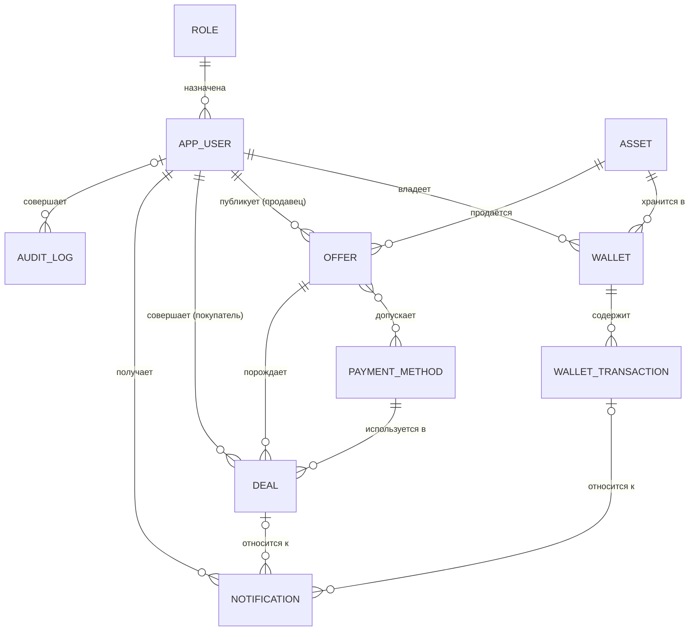
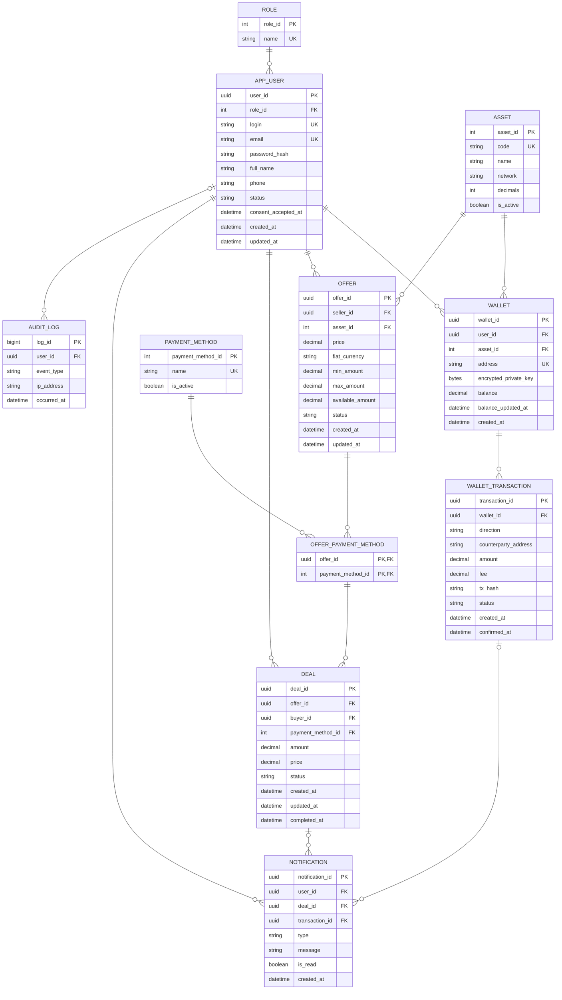

## 1.4. Построение концептуальной и логической модели данных

В разделах 1.1–1.3 были определены стейкхолдеры, пользовательские роли, реестр юзкейсов, нефункциональные требования и диаграммы вариантов использования. Эти материалы описывают, что пользователи делают в программном комплексе AEON, но не отвечают на вопрос, какие данные для этого нужны, где они хранятся и как связаны между собой. Ответ на этот вопрос даёт модель данных. Она строится в два шага: концептуальная модель фиксирует предметную область в виде сущностей и связей без технических подробностей, а логическая модель детализирует её атрибутами, типами данных, ключами и приводит к третьей нормальной форме. Привязка к конкретной СУБД (физическая модель) в данном разделе не выполняется.

### 1.4.1. Исходные данные и порядок построения модели

Источниками для построения модели послужили:

- реестр юзкейсов (таблица 2): из пользовательских историй и сценариев выделены понятия предметной области и данные, с которыми работает пользователь;
- перечень условий и расширяющих действий (таблицы 14 и 15): они показывают, какие данные проверяются и какие состояния объектов меняются;
- нефункциональные требования FURPS+ (таблицы 5–10): они задают ограничения на хранение данных (хэш пароля, шифрование приватных ключей, точность денежных величин, состав записи журнала, согласие на обработку данных, использование реляционной СУБД).

Модель строилась в следующем порядке:

1. выявление сущностей: из текстов пользовательских историй выписаны существительные и отобраны те, о которых системе необходимо хранить данные;
2. анализ потоков данных: для каждого юзкейса определено, какие данные поступают в систему, откуда и что из них сохраняется;
3. определение связей и их кратности и построение концептуальной ER-диаграммы;
4. описание атрибутов сущностей, назначение первичных и внешних ключей, построение логической модели;
5. нормализация и проверка модели по реестру юзкейсов.

### 1.4.2. Выявление сущностей и объектов

На первом шаге из пользовательских историй реестра юзкейсов были выписаны все существительные и для каждого принято решение: стать сущностью, стать атрибутом другой сущности, быть вычисляемым значением или не относиться к хранимым данным. Результат приведён в таблице 16.

Таблица 16 – Анализ понятий предметной области

| Понятие из пользовательских историй | Решение | Обоснование |
|---|---|---|
| Пользователь, учётная запись | Сущность «Пользователь» | Участник системы, о котором хранятся данные (US-0, US-1, US-14) |
| Администратор, обычный пользователь | Сущность «Роль» | Права доступа различаются, набор ролей конечен и меняется администратором (US-14) |
| Покупатель, продавец | Не сущности | Согласно п. 1.1.1 это не отдельные типы учётных записей, а роли одного пользователя в конкретной сделке; выражаются связями «Пользователь – Объявление» и «Пользователь – Сделка» |
| Логин, пароль, персональные данные | Атрибуты «Пользователя» | Описывают только пользователя (US-0, US-1) |
| Личный кабинет, главная страница | Не хранится | Элемент интерфейса |
| Кошелёк | Сущность «Кошелёк» | Хранит адрес, ключ и баланс по каждому активу (US-2, US-4, US-5) |
| Цифровой актив | Сущность «Актив» | Справочник активов с параметрами сети; на него ссылаются кошельки и объявления |
| Баланс | Атрибут «Кошелька» | Принадлежит конкретному кошельку |
| Адрес, QR-код | Атрибут «Кошелька» и вычисляемое значение | QR-код формируется из адреса и не хранится |
| Транзакция | Сущность «Транзакция» | Операция с собственными свойствами и жизненным циклом (US-3, US-4, US-5) |
| Комиссия, сумма, хэш транзакции | Атрибуты «Транзакции» | Описывают одну операцию |
| P2P-объявление | Сущность «Объявление» | Создаётся, редактируется и отключается продавцом, контролируется администратором (US-10, US-11, US-15) |
| Курс, лимиты | Атрибуты «Объявления» | Параметры одного объявления |
| Способ оплаты | Сущность «Способ оплаты» | Справочник; один способ используется во многих объявлениях, одно объявление допускает несколько способов |
| P2P-сделка | Сущность «Сделка» | Самостоятельный объект со статусом и историей (US-8, US-9, US-12, US-16) |
| Статус сделки, статус объявления | Атрибуты | Принимают значения из конечного набора |
| Рейтинг и история активности продавца | Вычисляемые значения | Определяются по завершённым сделкам продавца и отдельно не хранятся (US-7) |
| Уведомление | Сущность «Уведомление» | Создаётся системой по событию и затем читается пользователем (US-9, US-13) |
| Журнал событий, событие | Сущность «Событие журнала» | Хранится 12 месяцев, доступен только администратору (US-17, требования группы F) |
| Согласие на обработку данных | Атрибут «Пользователя» | Требуется хранить факт согласия и дату |

В результате выделено десять сущностей предметной области: «Роль», «Пользователь», «Актив», «Кошелёк», «Транзакция», «Способ оплаты», «Объявление», «Сделка», «Уведомление» и «Событие журнала». Ещё одна сущность, ассоциативная «Способ оплаты объявления», появится на логическом уровне при разрешении связи «многие ко многим».

### 1.4.3. Анализ потоков данных

Чтобы убедиться, что выделенных сущностей достаточно, для основных юзкейсов были описаны потоки данных: источник, приёмник, передаваемые данные и место их хранения. Результат приведён в таблице 17.

Таблица 17 – Потоки данных программного комплекса AEON

| Поток | Источник → приёмник | Передаваемые данные | Где сохраняется |
|---|---|---|---|
| Авторизация (US-0) | Пользователь → Система | Логин, пароль | Читается «Пользователь»; результат попытки входа пишется в «Событие журнала» |
| Изменение профиля (US-1) | Пользователь → Система | Новые персональные данные | «Пользователь» |
| Просмотр баланса (US-2) | Блокчейн-сеть → Система → Пользователь | Актуальный баланс адреса | «Кошелёк» (значение баланса и время обновления) |
| История операций (US-3) | Система → Пользователь | Список транзакций кошелька | Читается «Транзакция» |
| Отправка криптовалюты (US-4) | Пользователь → Система → Блокчейн-сеть | Адрес получателя, сумма, комиссия; хэш и статус транзакции | «Транзакция», «Кошелёк», «Событие журнала», «Уведомление» |
| Получение криптовалюты (US-5) | Блокчейн-сеть → Система | Входящая транзакция на адрес пользователя | «Транзакция», «Кошелёк», «Уведомление» |
| Создание и изменение объявления (US-10, US-11) | Продавец → Система | Актив, курс, лимиты, способы оплаты, статус | «Объявление», «Способ оплаты объявления», «Событие журнала» |
| Поиск предложений и информация о продавце (US-6, US-7) | Покупатель → Система | Параметры фильтра | Читаются «Объявление», «Сделка» (для расчёта рейтинга) |
| Создание сделки (US-8) | Покупатель → Система → Продавец | Объявление, сумма, способ оплаты | «Сделка», «Уведомление» продавцу |
| Изменение состояния сделки (US-9) | Участник сделки → Система | Новый статус | «Сделка», «Уведомление» второму участнику, «Событие журнала» |
| Управление пользователями и объявлениями (US-14, US-15) | Администратор → Система | Состояние учётной записи, роль, статус объявления | «Пользователь», «Объявление», «Событие журнала» |
| Просмотр журнала (US-17) | Администратор → Система | Период, фильтры | Читается «Событие журнала» |

Анализ потоков показал, что каждый поток данных начинается или заканчивается в одной из выделенных сущностей, а данные, которые приходят из блокчейн-сети, сохраняются как «Транзакция» и «Кошелёк». Данных, для которых не нашлось бы места хранения, не обнаружено.

### 1.4.4. Концептуальная модель данных

На втором шаге определены связи между сущностями и их кратность. Описание связей приведено в таблице 18, а концептуальная ER-диаграмма – на рисунке 11.

Таблица 18 – Связи между сущностями концептуальной модели

| Связь | Тип | Содержательное описание |
|---|---|---|
| Роль – Пользователь | 1 : N | Одна роль назначается многим пользователям; у пользователя ровно одна роль |
| Пользователь – Кошелёк | 1 : N | Пользователь владеет кошельками по разным активам |
| Актив – Кошелёк | 1 : N | Кошельки создаются в разрезе активов |
| Кошелёк – Транзакция | 1 : N | В истории кошелька много транзакций |
| Пользователь – Объявление | 1 : N | Пользователь в роли продавца публикует несколько объявлений |
| Актив – Объявление | 1 : N | Объявление относится к одному активу |
| Объявление – Способ оплаты | M : N | Объявление допускает несколько способов оплаты, способ используется во многих объявлениях |
| Объявление – Сделка | 1 : N | По одному объявлению может быть заключено несколько сделок |
| Пользователь – Сделка | 1 : N | Пользователь в роли покупателя участвует во многих сделках |
| Способ оплаты – Сделка | 1 : N | В сделке выбирается один способ оплаты |
| Пользователь – Уведомление | 1 : N | Пользователь получает много уведомлений |
| Сделка – Уведомление | 1 : N (необязательная) | Уведомление может относиться к сделке |
| Транзакция – Уведомление | 1 : N (необязательная) | Уведомление может относиться к транзакции |
| Пользователь – Событие журнала | 1 : N (необязательная) | Событие совершает пользователь; при неудачном входе с неизвестным логином пользователь не определён |

Продавец сделки отдельной связью не хранится: он определяется через объявление, по которому создана сделка.

Рисунок 11 – Концептуальная ER-диаграмма программного комплекса AEON

### 1.4.5. Логическая модель данных

Логическая модель получена из концептуальной в результате следующих преобразований:

- каждой сущности добавлен первичный ключ; для сущностей, объекты которых создаются пользователями или системой, выбран суррогатный идентификатор типа UUID, для справочников – целочисленный;
- связи «один ко многим» реализованы внешними ключами на стороне «многие»;
- связь «многие ко многим» между объявлением и способом оплаты разрешена ассоциативной сущностью «Способ оплаты объявления» с составным первичным ключом;
- для каждой сущности определены атрибуты и типы данных с учётом нефункциональных требований: денежные величины и количество актива хранятся в десятичном формате с 18 знаками после запятой, пароль – только в виде хэша, приватный ключ – только в зашифрованном виде, время – в UTC.

Логическая ER-диаграмма приведена на рисунке 12, описание атрибутов – в таблицах 19–29.

Рисунок 12 – Логическая ER-диаграмма программного комплекса AEON

Таблица 19 – Сущность «Роль» (ROLE)

| Атрибут | Тип | Ключ | Обязательность | Описание |
|---|---|---|---|---|
| role_id | Целое | PK | да | Идентификатор роли |
| name | Строка(30) | UK | да | Название роли: USER, ADMIN |

Таблица 20 – Сущность «Пользователь» (APP_USER)

| Атрибут | Тип | Ключ | Обязательность | Описание |
|---|---|---|---|---|
| user_id | UUID | PK | да | Идентификатор пользователя |
| role_id | Целое | FK → ROLE | да | Роль пользователя |
| login | Строка(50) | UK | да | Логин |
| email | Строка(255) | UK | да | Адрес электронной почты |
| password_hash | Строка(255) | | да | Хэш пароля с индивидуальной солью (Argon2id или bcrypt) |
| full_name | Строка(100) | | нет | Имя пользователя |
| phone | Строка(20) | | нет | Номер телефона |
| status | Строка(20) | | да | Состояние учётной записи: ACTIVE, BLOCKED |
| consent_accepted_at | Дата и время | | да | Дата и время согласия на обработку персональных данных |
| created_at | Дата и время | | да | Дата регистрации (UTC) |
| updated_at | Дата и время | | да | Дата последнего изменения (UTC) |

Таблица 21 – Сущность «Актив» (ASSET)

| Атрибут | Тип | Ключ | Обязательность | Описание |
|---|---|---|---|---|
| asset_id | Целое | PK | да | Идентификатор актива |
| code | Строка(10) | UK | да | Код актива (тикер) |
| name | Строка(50) | | да | Название актива |
| network | Строка(50) | | да | Блокчейн-сеть (тестовая сеть) |
| decimals | Целое | | да | Количество знаков после запятой, не более 18 |
| is_active | Логический | | да | Доступен ли актив для новых кошельков и объявлений |

Таблица 22 – Сущность «Кошелёк» (WALLET)

| Атрибут | Тип | Ключ | Обязательность | Описание |
|---|---|---|---|---|
| wallet_id | UUID | PK | да | Идентификатор кошелька |
| user_id | UUID | FK → APP_USER | да | Владелец |
| asset_id | Целое | FK → ASSET | да | Актив кошелька |
| address | Строка(100) | UK | да | Публичный адрес в блокчейн-сети |
| encrypted_private_key | Двоичные данные | | да | Приватный ключ в зашифрованном виде (AES-256-GCM) |
| balance | Десятичное(38,18) | | да | Последний полученный баланс адреса |
| balance_updated_at | Дата и время | | да | Время последней синхронизации баланса |
| created_at | Дата и время | | да | Дата создания (UTC) |

Дополнительное ограничение: пара (user_id, asset_id) уникальна, то есть у пользователя один кошелёк на каждый актив.

Таблица 23 – Сущность «Транзакция» (WALLET_TRANSACTION)

| Атрибут | Тип | Ключ | Обязательность | Описание |
|---|---|---|---|---|
| transaction_id | UUID | PK | да | Идентификатор записи |
| wallet_id | UUID | FK → WALLET | да | Кошелёк, в истории которого отображается операция |
| direction | Строка(3) | | да | Направление: IN (получение), OUT (отправка) |
| counterparty_address | Строка(100) | | да | Адрес второй стороны операции |
| amount | Десятичное(38,18) | | да | Сумма операции |
| fee | Десятичное(38,18) | | да | Комиссия сети |
| tx_hash | Строка(100) | | да | Хэш транзакции в блокчейн-сети |
| status | Строка(20) | | да | PENDING, CONFIRMED, FAILED |
| created_at | Дата и время | | да | Время создания (UTC) |
| confirmed_at | Дата и время | | нет | Время подтверждения сетью |

Дополнительное ограничение: пара (wallet_id, tx_hash) уникальна. Если обе стороны операции являются кошельками AEON, в истории каждого из них создаётся своя запись.

Таблица 24 – Сущность «Способ оплаты» (PAYMENT_METHOD)

| Атрибут | Тип | Ключ | Обязательность | Описание |
|---|---|---|---|---|
| payment_method_id | Целое | PK | да | Идентификатор способа оплаты |
| name | Строка(100) | UK | да | Название способа оплаты |
| is_active | Логический | | да | Доступен ли способ для выбора |

Таблица 25 – Сущность «Объявление» (OFFER)

| Атрибут | Тип | Ключ | Обязательность | Описание |
|---|---|---|---|---|
| offer_id | UUID | PK | да | Идентификатор объявления |
| seller_id | UUID | FK → APP_USER | да | Продавец |
| asset_id | Целое | FK → ASSET | да | Продаваемый актив |
| price | Десятичное(18,2) | | да | Курс: цена единицы актива в фиатной валюте |
| fiat_currency | Строка(3) | | да | Код фиатной валюты |
| min_amount | Десятичное(38,18) | | да | Минимальная сумма сделки |
| max_amount | Десятичное(38,18) | | да | Максимальная сумма сделки |
| available_amount | Десятичное(38,18) | | да | Остаток актива, доступный для продажи |
| status | Строка(20) | | да | ACTIVE, DISABLED, BLOCKED |
| created_at | Дата и время | | да | Время создания (UTC) |
| updated_at | Дата и время | | да | Время последнего изменения (UTC) |

Дополнительное ограничение: min_amount не превышает max_amount.

Таблица 26 – Сущность «Способ оплаты объявления» (OFFER_PAYMENT_METHOD)

| Атрибут | Тип | Ключ | Обязательность | Описание |
|---|---|---|---|---|
| offer_id | UUID | PK, FK → OFFER | да | Объявление |
| payment_method_id | Целое | PK, FK → PAYMENT_METHOD | да | Допустимый способ оплаты |

Таблица 27 – Сущность «Сделка» (DEAL)

| Атрибут | Тип | Ключ | Обязательность | Описание |
|---|---|---|---|---|
| deal_id | UUID | PK | да | Идентификатор сделки |
| offer_id | UUID | FK → OFFER_PAYMENT_METHOD | да | Объявление, по которому создана сделка |
| payment_method_id | Целое | FK → OFFER_PAYMENT_METHOD | да | Выбранный способ оплаты |
| buyer_id | UUID | FK → APP_USER | да | Покупатель |
| amount | Десятичное(38,18) | | да | Количество приобретаемого актива |
| price | Десятичное(18,2) | | да | Курс, зафиксированный на момент создания сделки |
| status | Строка(20) | | да | CREATED, PAID, COMPLETED, CANCELLED |
| created_at | Дата и время | | да | Время создания (UTC) |
| updated_at | Дата и время | | да | Время последнего изменения (UTC) |
| completed_at | Дата и время | | нет | Время завершения или отмены |

Пара (offer_id, payment_method_id) является составным внешним ключом на таблицу OFFER_PAYMENT_METHOD, поэтому в сделке нельзя выбрать способ оплаты, который не указан в объявлении. Продавец сделки определяется через OFFER.seller_id. Курс сохраняется в сделке, потому что продавец может изменить курс в объявлении уже после создания сделки.

Таблица 28 – Сущность «Уведомление» (NOTIFICATION)

| Атрибут | Тип | Ключ | Обязательность | Описание |
|---|---|---|---|---|
| notification_id | UUID | PK | да | Идентификатор уведомления |
| user_id | UUID | FK → APP_USER | да | Получатель |
| deal_id | UUID | FK → DEAL | нет | Связанная сделка |
| transaction_id | UUID | FK → WALLET_TRANSACTION | нет | Связанная транзакция |
| type | Строка(30) | | да | Тип события |
| message | Строка(500) | | да | Текст уведомления |
| is_read | Логический | | да | Прочитано ли уведомление |
| created_at | Дата и время | | да | Время создания (UTC) |

Дополнительное ограничение: заполнено не более одного из полей deal_id и transaction_id.

Таблица 29 – Сущность «Событие журнала» (AUDIT_LOG)

| Атрибут | Тип | Ключ | Обязательность | Описание |
|---|---|---|---|---|
| log_id | Большое целое | PK | да | Идентификатор записи |
| user_id | UUID | FK → APP_USER | нет | Пользователь; не заполняется, если вход выполнен с неизвестным логином |
| event_type | Строка(50) | | да | Тип события: вход, отправка транзакции, изменение объявления, смена статуса сделки, действие администратора |
| ip_address | Строка(45) | | да | IP-адрес |
| occurred_at | Дата и время | | да | Дата и время события (UTC) |

Состав атрибутов записи журнала соответствует нефункциональному требованию: дата и время, идентификатор пользователя, тип события и IP-адрес. Для записей старше 12 месяцев выполняется задание очистки, поэтому ограничение внешнего ключа на пользователя не мешает удалению старых данных.

### 1.4.6. Нормализация модели

Логическая модель была проверена на соответствие нормальным формам. Результаты приведены в таблице 30.

Таблица 30 – Проверка нормальных форм

| Форма | Требование | Как выполнено в модели |
|---|---|---|
| 1НФ | Атрибуты атомарны, нет повторяющихся групп | Список способов оплаты объявления не хранится в одном поле, а вынесен в отдельную таблицу OFFER_PAYMENT_METHOD |
| 2НФ | Неключевые атрибуты зависят от всего ключа | Составной ключ только у OFFER_PAYMENT_METHOD, и неключевых атрибутов там нет; остальные таблицы имеют одно ключевое поле |
| 3НФ | Нет зависимостей неключевых атрибутов друг от друга | Название роли вынесено в ROLE, названия способов оплаты – в PAYMENT_METHOD, параметры актива – в ASSET; актив транзакции определяется через кошелёк, продавец сделки – через объявление, сумма сделки в фиате вычисляется как amount × price и не хранится, рейтинг продавца вычисляется по сделкам |

Единственным сознательным отступлением от полной нормализации является хранение баланса в таблице WALLET. Баланс определяется состоянием блокчейн-сети, а не только записями в базе, поэтому хранится как последнее полученное значение с отметкой времени и используется, чтобы не обращаться к сети при каждом просмотре.

### 1.4.7. Проверка модели по реестру юзкейсов

Чтобы убедиться, что модель покрывает все сценарии, для каждого юзкейса из реестра определены сущности, которые он читает или изменяет (таблица 31).

Таблица 31 – Соответствие юзкейсов и сущностей модели

| Юзкейс | Читает | Изменяет |
|---|---|---|
| US-0 Авторизация | APP_USER | AUDIT_LOG |
| US-1 Управление персональными данными | APP_USER | APP_USER |
| US-2 Просмотр баланса кошелька | WALLET, ASSET | WALLET |
| US-3 Просмотр истории транзакций | WALLET_TRANSACTION, WALLET | – |
| US-4 Отправка криптовалюты | WALLET, ASSET | WALLET_TRANSACTION, WALLET, AUDIT_LOG, NOTIFICATION |
| US-5 Получение криптовалюты | WALLET | WALLET_TRANSACTION, WALLET, NOTIFICATION |
| US-6 Поиск P2P-предложения | OFFER, ASSET, PAYMENT_METHOD, OFFER_PAYMENT_METHOD | – |
| US-7 Просмотр информации о продавце | APP_USER, OFFER, DEAL | – |
| US-8 Создание P2P-сделки | OFFER, OFFER_PAYMENT_METHOD | DEAL, NOTIFICATION |
| US-9 Отслеживание состояния сделки | DEAL, NOTIFICATION | DEAL, NOTIFICATION, AUDIT_LOG |
| US-10 Создание P2P-объявления | ASSET, PAYMENT_METHOD | OFFER, OFFER_PAYMENT_METHOD, AUDIT_LOG |
| US-11 Редактирование P2P-объявления | OFFER, OFFER_PAYMENT_METHOD | OFFER, OFFER_PAYMENT_METHOD, AUDIT_LOG |
| US-12 Просмотр истории P2P-сделок | DEAL, OFFER | – |
| US-13 Просмотр уведомлений | NOTIFICATION | NOTIFICATION |
| US-14 Управление пользователями | APP_USER, ROLE | APP_USER, AUDIT_LOG |
| US-15 Контроль P2P-объявлений | OFFER | OFFER, AUDIT_LOG |
| US-16 Просмотр информации о P2P-сделках | DEAL, OFFER, APP_USER | – |
| US-17 Просмотр журнала событий | AUDIT_LOG | – |

Каждый юзкейс из реестра опирается на сущности модели, а каждая сущность используется хотя бы одним юзкейсом, поэтому модель не содержит лишних и не пропускает необходимых объектов.

Таким образом, на основе реестра юзкейсов и нефункциональных требований построена концептуальная модель, содержащая десять сущностей и связи между ними, и на её основе разработана логическая модель из одиннадцати таблиц с типами данных, первичными и внешними ключами. Модель приведена к третьей нормальной форме и проверена по всем семнадцати юзкейсам. Она служит основой для проектирования физической модели в выбранной реляционной СУБД и для разработки серверной части программного комплекса.
